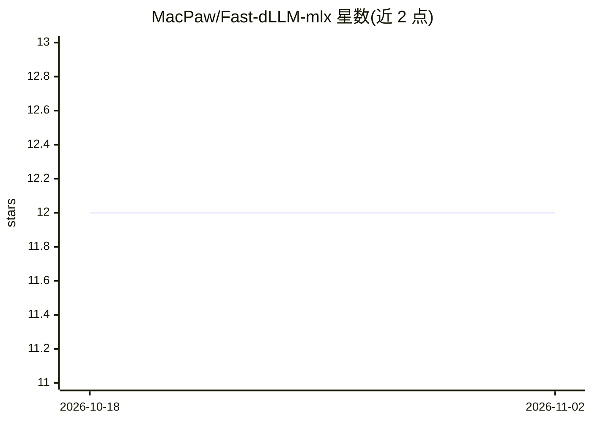

# MacPaw/Fast-dLLM-mlx

⭐ 12 · Python · Apache-2.0 · 推送 2026-08-04 · [GitHub](https://github.com/MacPaw/Fast-dLLM-mlx) · 组织维护

**Apple Silicon 上扩散语言模型的 MLX 推理加速实现**

MacPaw 发布的 MLX 推理实现，将 NVLabs/Fast-dLLM 的免训练加速思路移植到 Apple Silicon，面向 Dream 风格扩散语言模型（如 DiffuCoder）与 DiffusionGemma。提供双缓存解码、带概率阈值的并行 token 生成，并附带多个基准脚本与 mlx-vlm 等路径的对比。基准提示集来自 prompts/ 目录的有限样本，结果定位为方向性参考；需 uv 或 pip 从源码安装，运行于 MLX 环境。

## 筛选速览

| 维度 | 判定 | 备注 |
|---|---|---|
| AI 角色 | `ai-native` | 本体是模型或模型工具 |
| 许可风险 | `permissive` | Apache-2.0 |
| 部署形态 | `library` | 以包/库形式分发 |
| 模型依赖 | — | README 未给出锁定关系 |
| 硬件要求 | — | 无带数字的原话,不猜 |
| 安装摩擦 | `low` | 无编译、无系统依赖或容器化 |
| 成熟度 | `idea` | |

## 能力要点

- Dream 架构在 MLX 上的推理实现
- Fast-dLLM 免训练加速思路的 MLX 版本（双缓存解码、并行 token 生成）
- 含 DiffusionGemma 推理与 Fast DiffusionGemma 路径
- 多组基准脚本输出 CSV/JSON 汇总

## 适用场景

- 在 Mac 上运行 Dream 风格扩散语言模型并加速推理
- 对比 MLX 各变体与 Qwen mlx_lm 基线的生成性能
- 研究块扩散生成在 Apple Silicon 上的表现

## 场景标签

`推理引擎` · 领域:训练与推理

## 证据(README 行号)

> L5: `Fast-dLLM-mlx` implements Dream architecture inference in MLX for Apple Silicon.
> L9: Dream-style diffusion language models. The focus here is training-free
> L16: - Dream architecture inference in MLX

## 星数曲线

2026-10-18 12 → 2026-11-02 12（+0）

---
*卡片 v1 · prompt 1.4 · 生成 2026-11-02 · 置信度 mid · 依据 README sha `44549947649d` · [字段定义](../../DATASET.md)*
