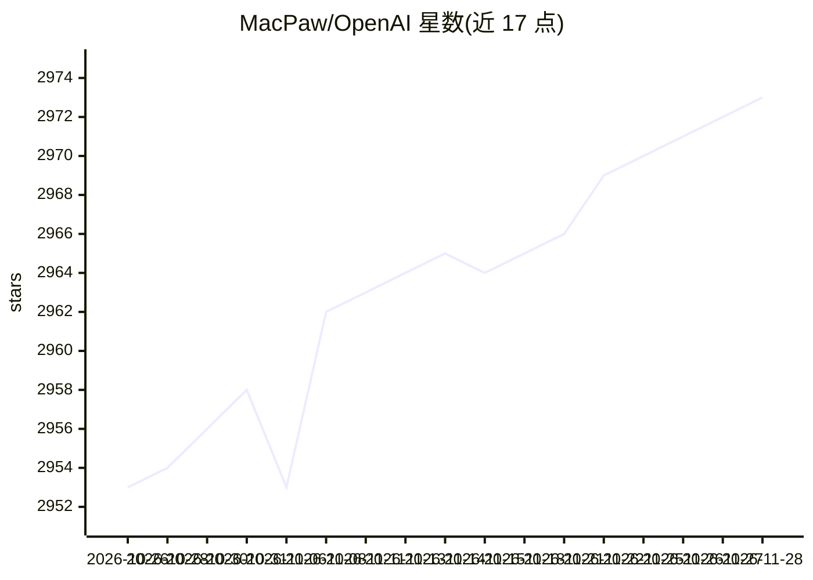

# MacPaw/OpenAI

⭐ 2,973 · Swift · MIT · 推送 2026-11-24 · [GitHub](https://github.com/MacPaw/OpenAI) · 组织维护

**Swift 社区维护的 OpenAI 公共 API 客户端库**

由 Swift 社区（MacPaw）维护的 OpenAI 公共 REST API 的 Swift 实现，类型与方法按 OpenAI 平台文档对应。通过 Swift Package Manager 集成到 Xcode 工程或 Package.swift。功能覆盖 Responses、Chat Completions（含流式）、Function calling、图像生成/编辑/变体、语音合成（含流式）与 Whisper 转录/翻译，以及音频输入输出的 Chat 调用；支持 Swift Concurrency、Combine 与闭包三种调用方式并可取消请求。支持 relaxed 解析以配合其他 OpenAI 兼容 API 提供方，配置项包含 host、basePath、port、scheme 与自定义请求头。

## 筛选速览

| 维度 | 判定 | 备注 |
|---|---|---|
| AI 角色 | `ai-ecosystem` | LLM/agent 周边工具 |
| 许可风险 | `permissive` | MIT |
| 部署形态 | `None` |  |
| 模型依赖 | — | README 未给出锁定关系 |
| 硬件要求 | — | 无带数字的原话,不猜 |
| 安装摩擦 | `low` | 无编译、无系统依赖或容器化 |
| 成熟度 | — | 结构信号不足 |

## 能力要点

- 按 OpenAI REST API 文档实现的类型与方法，入口为 OpenAI 类
- 覆盖 Chat Completions、Responses、Function calling、图像与语音（TTS/转录/翻译）接口
- 支持 Swift Concurrency、Combine 与闭包调用，请求可取消
- relaxed 解析模式可配合其他 OpenAI 兼容 API 提供方

## 适用场景

- 在 iOS/macOS 应用中调用 OpenAI 的对话与文本生成接口
- 在 Swift 工程中接入图像生成与编辑功能
- 在 Swift 应用中实现语音合成与音频转录/翻译
- 通过 relaxed 模式接入其他 OpenAI 兼容 API 提供方

## 场景标签

`图像生成` `语音合成` `语音识别` · 领域:内容生成

## 证据(README 行号)

> L9: This repository contains Swift community-maintained implementation over OpenAI public API.
> L65: This SDK is more focused on working with OpenAI Platform, but also works with other providers that support OpenAI-c

## 星数曲线

2026-10-26 2,953 → 2026-11-28 2,973（+20）

---
*卡片 v1 · prompt 1.4 · 生成 2026-11-26 · 置信度 high · 依据 README sha `4418a2300d33` · [字段定义](../../DATASET.md)*
