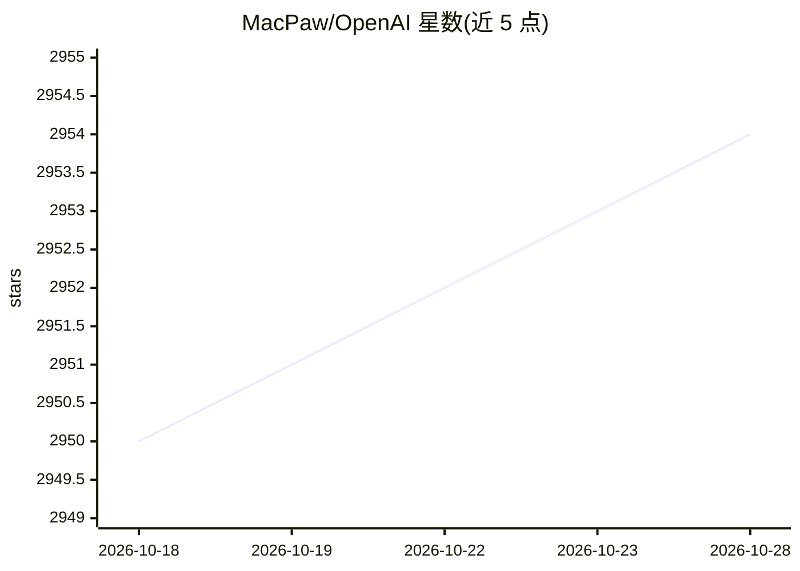

# MacPaw/OpenAI

⭐ 2,954 · Swift · MIT · 推送 2026-10-27 · [GitHub](https://github.com/MacPaw/OpenAI) · 组织维护

**Swift 社区维护的 OpenAI API 客户端 SDK，供 iOS/macOS 开发者调用**

MacPaw 维护的 Swift 包，按 OpenAI REST API 文档封装类型与方法，覆盖 Responses、Chat Completions（含流式）、Function calling、图像生成/编辑/变体、语音合成/转录/翻译及音频输入输出。通过 Swift Package Manager 集成到 Xcode 项目，支持 Closure、Combine 与 Swift Concurrency 三种调用方式并可取消请求；经 .relaxed 解析选项也可对接 OpenAI 兼容的其他提供方。README 提醒 API key 需经自有后端保管，勿在客户端暴露。

## 筛选速览

| 维度 | 判定 | 备注 |
|---|---|---|
| AI 角色 | `ai-ecosystem` | LLM/agent 周边工具 |
| 许可风险 | `permissive` | MIT |
| 部署形态 | `None` |  |
| 模型依赖 | — | README 未给出锁定关系 |
| 硬件要求 | — | 无带数字的原话,不猜 |
| 安装摩擦 | `low` | 无编译、无系统依赖或容器化 |
| 成熟度 | — | 结构信号不足 |

## 能力要点

- 覆盖 Responses / Chat Completions / 图像 / 音频端点的类型化封装
- Closure、Combine、Swift Concurrency 三种调用方式，均支持取消
- .relaxed 解析选项支持 OpenAI 兼容的其他提供方
- Configuration 可自定义 host/basePath/port/scheme/customHeaders

## 适用场景

- 在 Swift 应用中调用 OpenAI 文本、图像与音频 API
- 构建 Function calling 与流式输出的对话功能
- 通过自定义 host 接入 OpenAI 兼容的自建服务

## 场景标签

 · 领域:LLM API 客户端/移动开发

## 证据(README 行号)

> L9: This repository contains Swift community-maintained implementation over OpenAI public API.
> L65: This SDK is more focused on working with OpenAI Platform, but also works with other providers that support OpenAI-c

## 星数曲线

2026-10-18 2,950 → 2026-10-28 2,954（+4）

---
*卡片 v1 · prompt 1.4 · 生成 2026-10-21 · 置信度 high · 依据 README sha `dda912490723` · [字段定义](../../DATASET.md)*
