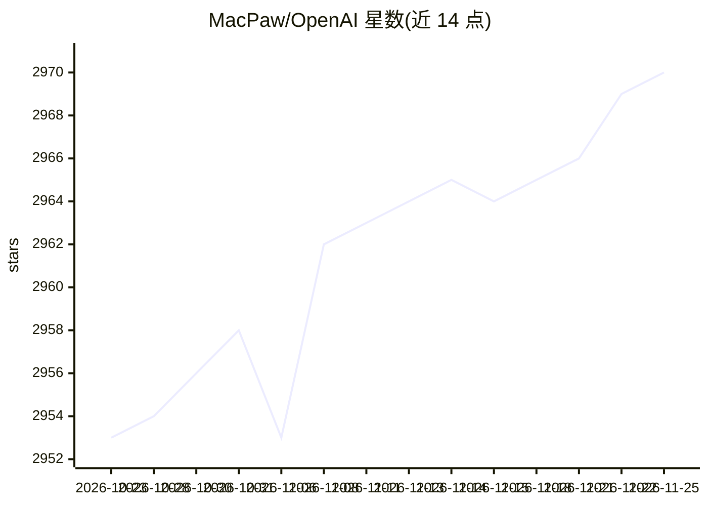

# MacPaw/OpenAI

⭐ 2,970 · Swift · MIT · 推送 2026-11-21 · [GitHub](https://github.com/MacPaw/OpenAI) · 组织维护

**Swift 开发者接入 OpenAI 公开 API 的社区维护 SDK**

由 MacPaw 维护的 Swift 社区实现，封装 OpenAI 公开 REST API 的类型与方法。支持 Swift Package Manager 集成，覆盖 Responses、Chat Completions、Function calling、图像生成/编辑/变体、语音合成（含流式）、音频转录与翻译、带音频输入输出的对话等端点。支持 Swift Concurrency、闭包回调与 Combine 三种调用方式及请求取消；通过 .relaxed 解析选项可接入兼容 OpenAI API 的其他提供方。需自备 API token，官方建议客户端应用经后端代理转发请求以保护密钥。

## 筛选速览

| 维度 | 判定 | 备注 |
|---|---|---|
| AI 角色 | `ai-ecosystem` | LLM/agent 周边工具 |
| 许可风险 | `permissive` | MIT |
| 部署形态 | `None` |  |
| 模型依赖 | — | README 未给出锁定关系 |
| 硬件要求 | — | 无带数字的原话,不猜 |
| 安装摩擦 | `low` | 无编译、无系统依赖或容器化 |
| 成熟度 | — | 结构信号不足 |

## 能力要点

- 封装 Responses、Chat Completions、Function calling、图像与音频等 OpenAI API 端点
- 支持 Swift Concurrency / 闭包 / Combine 三种调用方式与请求取消
- 配置 .relaxed 解析后可接入 OpenAI 兼容 API 的其他提供方
- 通过 Swift Package Manager 集成，可自定义 host/basePath/port 等配置

## 适用场景

- 在 iOS/macOS 应用中调用 Chat Completions 生成文本
- 在 Swift 应用中实现图像生成、编辑与变体功能
- 在 Swift 应用中接入语音合成、转录与翻译功能
- 接入兼容 OpenAI API 的第三方提供方

## 场景标签

`图像生成` `语音合成` · 领域:内容生成

## 证据(README 行号)

> L9: This repository contains Swift community-maintained implementation over OpenAI public API.
> L63: ### Using the SDK for other providers except OpenAI
> L65: This SDK is more focused on working with OpenAI Platform, but also works with other providers that support OpenAI-c

## 星数曲线

2026-10-23 2,953 → 2026-11-25 2,970（+17）

---
*卡片 v1 · prompt 1.4 · 生成 2026-11-23 · 置信度 high · 依据 README sha `f5a451890371` · [字段定义](../../DATASET.md)*
