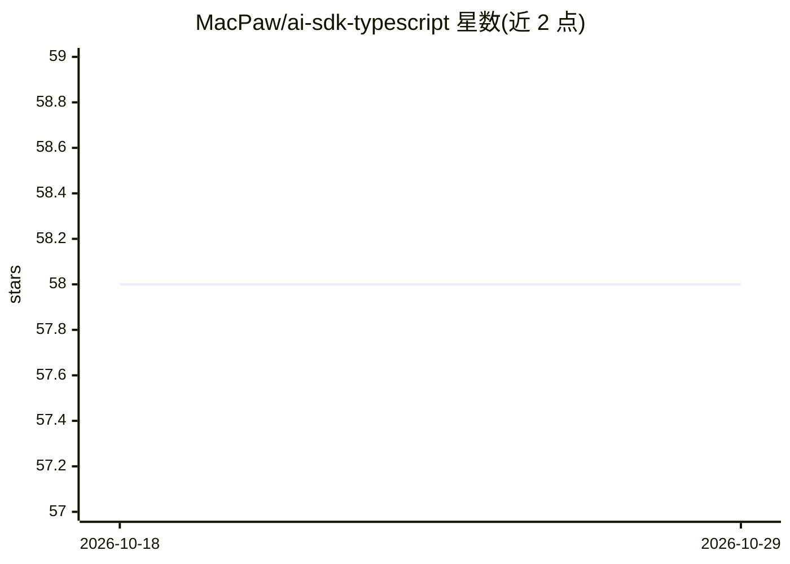

# MacPaw/ai-sdk-typescript

⭐ 58 · TypeScript · MIT · 推送 2026-10-26 · [GitHub](https://github.com/MacPaw/ai-sdk-typescript) · 组织维护

**MacPaw AI Gateway 的 TypeScript SDK：统一接入多模型与音视频端点**

MacPaw 官方维护的 Vercel AI SDK 扩展包，为 MacPaw AI Gateway 提供 OpenAI 兼容 provider（含 anthropic/google/xai/groq/mistral/bedrock/deepseek 等模型前缀路由）、通用 fetch 桥接、视频生成、语音列表、流式文本转语音与 AI 余额查询客户端，共享认证/重试/中间件/错误规范化管道，并提供可选的 NestJS 模块。核心生成 API 仍依赖上游 ai 与 @ai-sdk/* 包，本包仅添加 Gateway 特定构造。浏览器与 Node.js 均可运行，ESM+CJS 可摇树。

## 筛选速览

| 维度 | 判定 | 备注 |
|---|---|---|
| AI 角色 | `ai-ecosystem` | LLM/agent 周边工具 |
| 许可风险 | `permissive` | MIT |
| 部署形态 | `library` | 以包/库形式分发 |
| 模型依赖 | — | README 未给出锁定关系 |
| 硬件要求 | — | 无带数字的原话,不猜 |
| 安装摩擦 | `low` | 无编译、无系统依赖或容器化 |
| 成熟度 | — | 结构信号不足 |

## 能力要点

- OpenAI 兼容 provider，支持 11 类模型前缀路由
- 视频生成/语音列表/流式 TTS/余额查询专用客户端
- 共享 auth/401 自动刷新/指数退避重试/中间件/类型化错误管道
- 可选 NestJS 模块（AIGatewayModule、依赖注入、异常过滤器）

## 适用场景

- 在 Node.js/浏览器应用中通过统一 Gateway 调用多家模型
- NestJS 后端集中接入 AI 能力并处理认证与错误
- 调用视频生成、TTS、语音列表与额度查询端点

## 场景标签

`模型网关` · 领域:Agent 开发

## 证据(README 行号)

> L9: Thin **Vercel AI SDK** extension for **MacPaw AI Gateway**: OpenAI-compatible providers (`createAIGatewayProvider`, 
> L11: Core generation APIs stay on upstream **`ai`** and **`@ai-sdk/*`**. This package only adds Gateway-specific constru

## 星数曲线

2026-10-18 58 → 2026-10-29 58（+0）

---
*卡片 v1 · prompt 1.4 · 生成 2026-10-24 · 置信度 high · 依据 README sha `f3cd4d42b518` · [字段定义](../../DATASET.md)*
