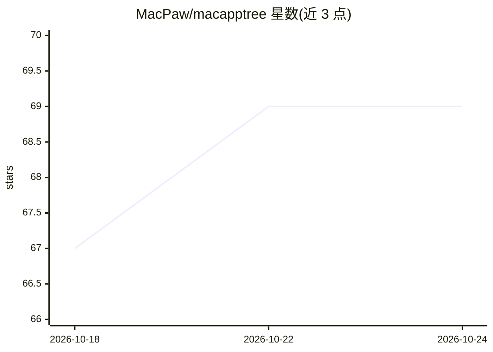

# MacPaw/macapptree

⭐ 69 · Python · MIT · 推送 2026-09-21 · [GitHub](https://github.com/MacPaw/macapptree) · 组织维护

**提取 macOS 应用无障碍树为 JSON 的 Python 库，供 UI 自动化使用**

由 MacPaw Research 维护的 Python 包，读取单个或多个 macOS 应用的 accessibility 树并输出 JSON，同时可截取应用窗口与全屏截图，生成按元素类型着色的带标注边界框分割图。支持捕获所有正在运行的可见应用，并包含 Dock 与顶部菜单栏。要求 macOS 与 Python 3.8+，pip 安装，提供 API（get_tree / get_tree_screenshot）与 CLI 两种用法。适用于无障碍测试、UI 自动化与可视化调试，常作为桌面 UI agent 的感知输入层。

## 筛选速览

| 维度 | 判定 | 备注 |
|---|---|---|
| AI 角色 | `ai-ecosystem` | LLM/agent 周边工具 |
| 许可风险 | `permissive` | MIT |
| 部署形态 | `library` | 以包/库形式分发 |
| 模型依赖 | — | README 未给出锁定关系 |
| 硬件要求 | — | 无带数字的原话,不猜 |
| 安装摩擦 | `low` | 无编译、无系统依赖或容器化 |
| 成熟度 | — | 结构信号不足 |

## 能力要点

- 提取单/多个 macOS 应用的 accessibility 树（JSON）
- 截图并生成按元素类型着色的标注边界框分割图
- 可覆盖全部可见应用并包含 Dock 与菜单栏
- 提供 Python API 与 CLI（python -m macapptree.main）

## 适用场景

- 为桌面 UI 自动化或 agent 获取结构化的界面元素树
- 无障碍测试中检查应用的元素层级
- UI 可视化调试时生成带标注的元素截图

## 场景标签

`GUI 自动化` · 领域:效率与自动化

## 证据(README 行号)

> L7: `macapptree` is a Python package that extracts the accessibility tree of a macOS applications screen in JSON format.
> L80: @article{garkot2025guirilla,

## 星数曲线

2026-10-18 67 → 2026-10-24 69（+2）

---
*卡片 v1 · prompt 1.4 · 生成 2026-10-24 · 置信度 mid · 依据 README sha `36edc3cad86f` · [字段定义](../../DATASET.md)*
