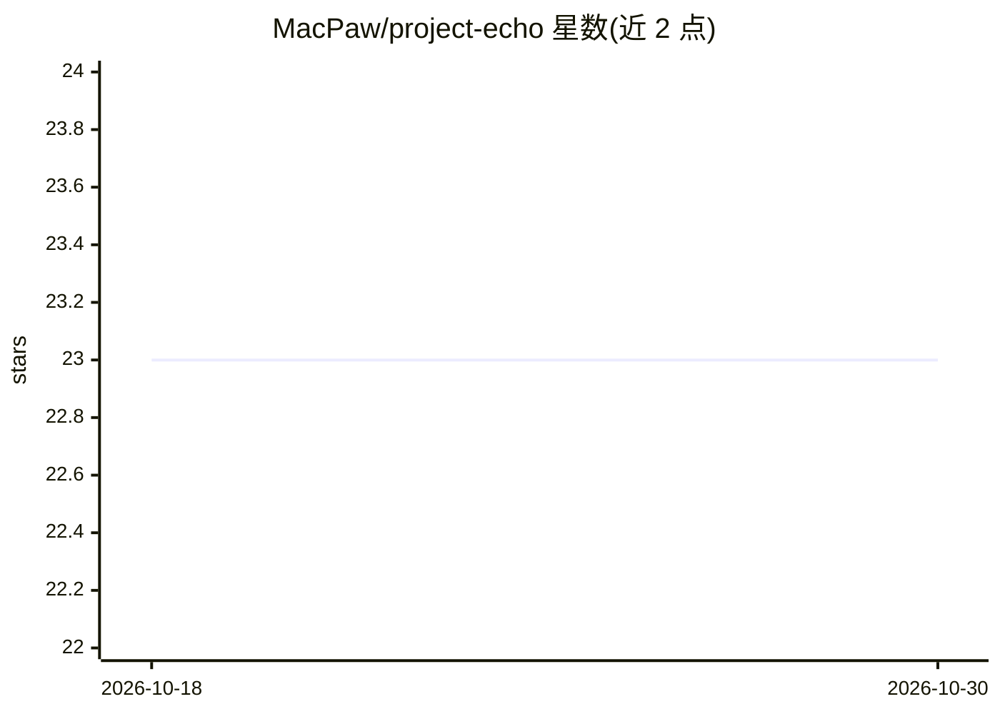

# MacPaw/project-echo

⭐ 23 · Swift · MIT · 推送 2026-09-21 · [GitHub](https://github.com/MacPaw/project-echo) · 组织维护

**macOS 原型应用：用 AI 与辅助功能 API 操作前台应用的文本区**

MacPaw Research 开发的 macOS 应用原型：检测当前前台应用，通过 Accessibility API 读取其文本区内容，将用户提示连同内容发送至 OpenAI API，并把生成的回复写回该文本区，以聊天界面展示交互过程。要求 macOS 14.0+、Xcode 15.0+ 与 OpenAI API key（需 GPT-4o 访问），首次启动需授予辅助功能权限。自述为实验性原型。

## 筛选速览

| 维度 | 判定 | 备注 |
|---|---|---|
| AI 角色 | `ai-native` | 本体是模型或模型工具 |
| 许可风险 | `permissive` | MIT |
| 部署形态 | `None` |  |
| 模型依赖 | — | README 未给出锁定关系 |
| 硬件要求 | — | 无带数字的原话,不猜 |
| 安装摩擦 | `low` | 无编译、无系统依赖或容器化 |
| 成熟度 | `idea` | |

## 能力要点

- 实时检测前台 macOS 应用并向其文本区发送/写回内容
- 基于 OpenAI API 生成回复（Agent 组件处理用户提示）
- SwiftUI 聊天界面展示交互
- 通过 OPEN_AI 环境变量配置 API key

## 适用场景

- 在 Xcode/TextMate 等原生文本编辑器内直接让 AI 改写或转换代码
- 以对话方式对前台应用的文本内容执行修复错别字等操作

## 场景标签

`AI 助手` `GUI 自动化` · 领域:效率与自动化

## 证据(README 行号)

> L11: **Echo** is a macOS application that demonstrates how to interact with macOS applications using Accessibility and O
> L18: - **User Prompts**: Send prompts to interact with the text area of the detected application.

## 星数曲线

2026-10-18 23 → 2026-10-30 23（+0）

---
*卡片 v1 · prompt 1.4 · 生成 2026-10-27 · 置信度 high · 依据 README sha `3236bd673f2a` · [字段定义](../../DATASET.md)*
