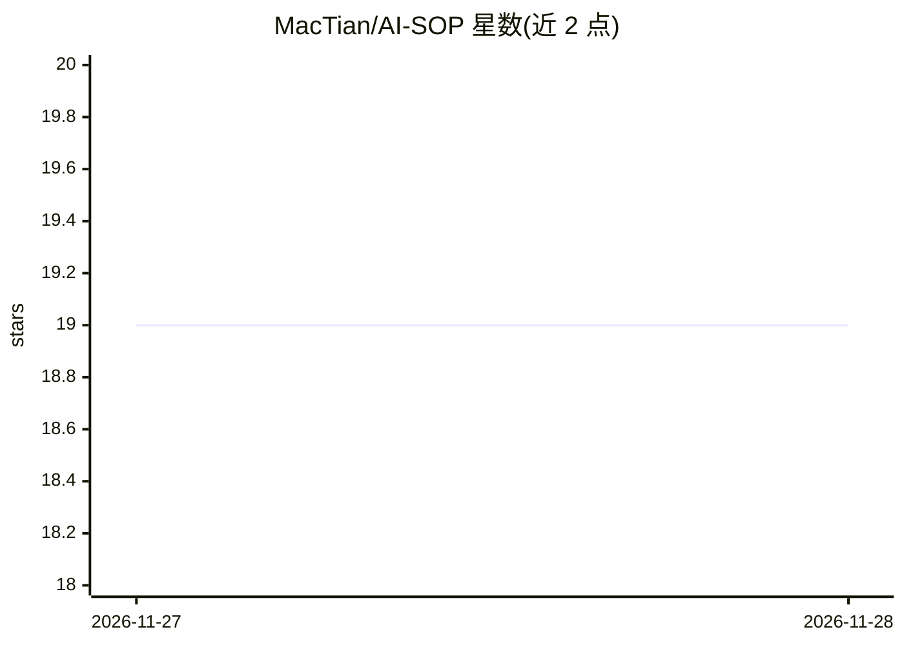

# MacTian/AI-SOP

⭐ 19 · Python · MIT · 推送 2026-11-26 · [GitHub](https://github.com/MacTian/AI-SOP) · 个人维护 · 中文 README

**制造业团队的实时 SOP 合规视觉监控应用**

端到端参考应用：摄像头视频流经 YOLO26 目标检测与 MediaPipe/LSTM 时序动作识别，按 YAML 定义的 SOP 规则驱动状态机，实现步骤确认、超时告警、截图存档、SQLite 记录与 Vue 仪表盘。内置标注与模型训练模块，支持 YOLO/COCO 格式导出。提供 mock 模式可在无相机/无 GPU 环境体验完整流程，支持 Docker 部署与 JWT 认证。

## 筛选速览

| 维度 | 判定 | 备注 |
|---|---|---|
| AI 角色 | `ai-native` | 本体是模型或模型工具 |
| 许可风险 | `permissive` | MIT |
| 部署形态 | `self-host` | docker 或自建部署 |
| 模型依赖 | — | README 未给出锁定关系 |
| 硬件要求 | — | 无带数字的原话,不猜 |
| 安装摩擦 | `low` | 无编译、无系统依赖或容器化 |
| 成熟度 | — | 结构信号不足 |

## 能力要点

- YOLO26 实时检测 + 80 类目标，支持 YOLOv8 与 mock 模式
- MediaPipe 手部关键点 + LSTM 时序分类与多尺度窗口投票
- 内置标注工具与在线 YOLO 训练（bbox/多边形、loss/mAP 监控）
- SOP 状态机带命中帧确认、超时检测与多级告警升级

## 适用场景

- 为产线装配/质检流程快速搭建合规监控原型
- 标注自有场景数据并训练专用检测模型
- 上传视频文件做离线 SOP 合规分析
- 作为完整 CV 应用学习研究的项目范例

## 场景标签

`目标检测` `模型训练` · 领域:感知与多模态

## 证据(README 行号)

> L20: AI SOP Monitor is an open-source, end-to-end reference application for real-time SOP compliance monitoring. It comb
> L63: - **YOLO26 Object Detection** — Default real-time detector for 80 object classes, with legacy YOLOv8 model support 

## 星数曲线

2026-11-27 19 → 2026-11-28 19（+0）

---
*卡片 v1 · prompt 1.4 · 生成 2026-11-27 · 置信度 high · 依据 README sha `698cd60d98d5` · [字段定义](../../DATASET.md)*
