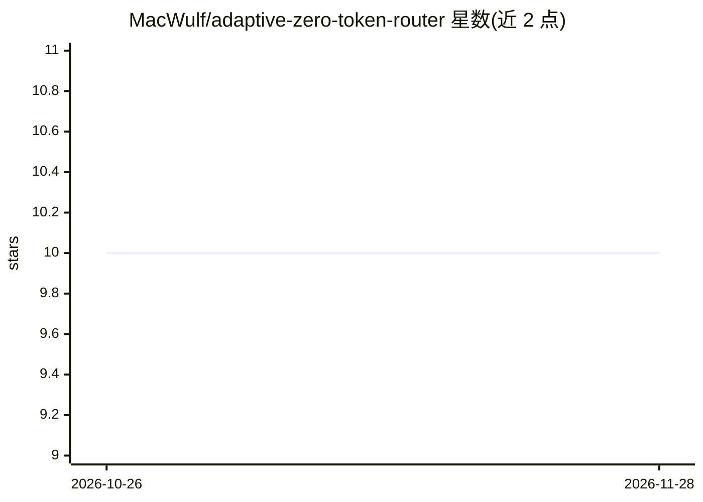

# MacWulf/adaptive-zero-token-router

⭐ 10 · TypeScript · MIT · 推送 2026-06-17 · [GitHub](https://github.com/MacWulf/adaptive-zero-token-router) · 个人维护

**LLM 调用前的本地零 token 意图路由库**

在 LLM 推理之前运行的本地路由库：对聊天、工具调用、编码、重构/调试、规划等提示词做确定性意图分类，输出 route/family/intent 三级结果，应用可将各 family 映射到不同模型。支持否定感知（"do not edit files" 不触发编码）、上一轮上下文、英/匈牙利语归一化，以及基于本地示例的可选自适应配置；带 eval 门控统计危险降路，并提供 CLI 评估 JSONL 语料。无网络调用、无 API key，路由本身仅耗 CPU。作者声明非语义分类器，高风险任务需强回退路由。

## 筛选速览

| 维度 | 判定 | 备注 |
|---|---|---|
| AI 角色 | `ai-ecosystem` | LLM/agent 周边工具 |
| 许可风险 | `permissive` | MIT |
| 部署形态 | `library` | 以包/库形式分发 |
| 模型依赖 | — | README 未给出锁定关系 |
| 硬件要求 | — | 无带数字的原话,不猜 |
| 安装摩擦 | `low` | 无编译、无系统依赖或容器化 |
| 成熟度 | `idea` | |

## 能力要点

- LLM 调用前的零 token 确定性路由，仅本地运行、无需 API key
- 否定感知与上一轮提示词上下文处理
- 自适应配置由本地批准示例构建，且有安全门控防止降级
- CLI 评估 JSONL 语料并输出危险降路/节省等指标

## 适用场景

- LLM 应用在每次调用前选择便宜或强的模型通道
- 本地优先桌面应用中的多语言提示词分流
- 为路由器配置建立评估门控与节省度量

## 场景标签

`模型网关` · 领域:Agent 开发

## 证据(README 行号)

> L3: Local, zero-token intent routing for prompts that need to choose between cheap chat, tooling, coding, refactor/debug
> L5: The library runs before any LLM call. It uses deterministic routing plus optional local adaptive examples. No prompt
> L78: Apps can map those families to models however they want.

## 星数曲线

2026-10-26 10 → 2026-11-28 10（+0）

---
*卡片 v1 · prompt 1.4 · 生成 2026-11-20 · 置信度 high · 依据 README sha `02c98c76eec2` · [字段定义](../../DATASET.md)*
