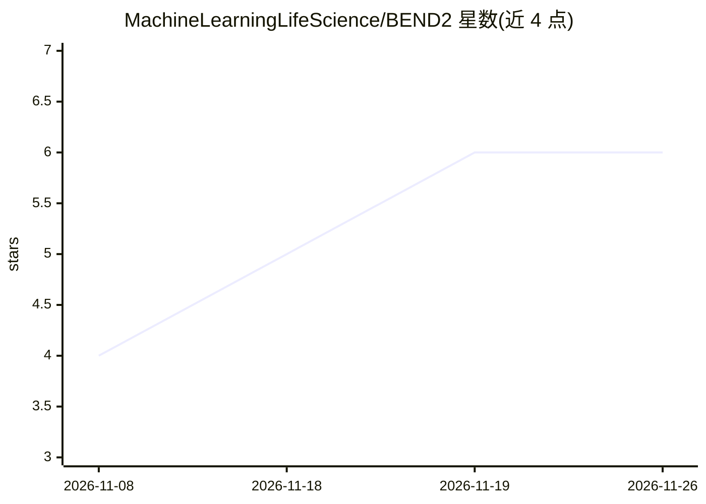

# MachineLearningLifeScience/BEND2

⭐ 6 · Python · MIT · 推送 2026-11-25 · [GitHub](https://github.com/MachineLearningLifeScience/BEND2) · [官网](https://machinelearninglifescience.github.io/BEND2/) · 组织维护

**评测基因组模型 DNA 设计能力的基准套件与排行榜**

BEND 2.0 是用于测试基因组模型能否指导 DNA 设计的基准：覆盖 8 项任务、5 类能力（隐藏碱基恢复、编辑效应预测、细胞/组织区分、背景交互、面向目标响应的序列选择），在冻结嵌入上拟合 readout 并按综合分排序。提供 pip 安装的 bend2 包、内置小数据集、bend2 run/plan/combine/show 等 CLI、结果 JSON/Parquet 输出，以及可提交模型的线上排行榜。需要 Python 3.11+，被评模型的框架与权重需另行安装。

## 筛选速览

| 维度 | 判定 | 备注 |
|---|---|---|
| AI 角色 | `ai-ecosystem` | LLM/agent 周边工具 |
| 许可风险 | `permissive` | MIT |
| 部署形态 | `library` | 以包/库形式分发 |
| 模型依赖 | — | README 未给出锁定关系 |
| 硬件要求 | — | 无带数字的原话,不猜 |
| 安装摩擦 | `low` | 无编译、无系统依赖或容器化 |
| 成熟度 | — | 结构信号不足 |

## 能力要点

- 8 项任务评测 5 类 DNA 设计相关能力，输出综合分与分项指标
- 基于冻结嵌入拟合 readout，内置适配器覆盖 DNABERT-2、NTv3、HyenaDNA
- bend2 run/plan/combine/show CLI，支持断点续跑与多任务结果合并
- 小数据集随包内置，大数据集从 Hugging Face 按需下载并做校验

## 适用场景

- 把自己的基因组基础模型接入基准并在排行榜提交结果
- 比较不同模型/读取头在 DNA 设计任务上的得分
- 在 CPU 上先跑内置 composition 基线熟悉流程

## 场景标签

`模型评测` · 领域:评测与运维

## 证据(README 行号)

> L3: We built BEND 2.0 to test whether genomic models can guide the design of DNA. Across eight tasks, we examine how the
> L34: ## Evaluate your model
> L36: BEND prepares the data and fits readouts to your model’s frozen embeddings.

## 星数曲线

2026-11-08 4 → 2026-11-26 6（+2）

---
*卡片 v1 · prompt 1.4 · 生成 2026-11-20 · 置信度 high · 依据 README sha `4760843a8f91` · [字段定义](../../DATASET.md)*
