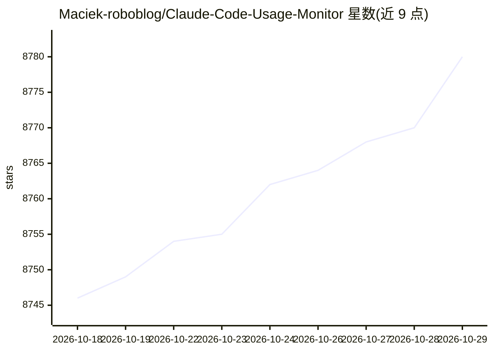

# Maciek-roboblog/Claude-Code-Usage-Monitor

⭐ 8,780 · Python · MIT · 推送 2026-07-05 · [GitHub](https://github.com/Maciek-roboblog/Claude-Code-Usage-Monitor) · 个人维护

**终端里的 Claude Code 用量/限额实时监控工具**

面向 Claude Code 用户的用量监控 CLI：以 Rich 实时终端界面展示 token、消息数与成本三类指标，支持 pro/max5/max20/team/custom 五种套餐口径，custom 档基于近 192 小时会话做 P90 自动限额检测。关键机制包括：--statusline 捕获官方 rate_limits 作为可信来源并按 official/local_estimate 等标签标注数据出处；--once/--compact/--write-state 提供版本化 JSON 快照与自动化退出码；opt-in 本地仓库可留存超出 Claude 30 天清理的历史并生成 CSV/JSON 报表；另含重置感知的配速与预测、多数据目录扫描。通过 PyPI 安装，数据仅在本地处理。

## 筛选速览

| 维度 | 判定 | 备注 |
|---|---|---|
| AI 角色 | `ai-ecosystem` | LLM/agent 周边工具 |
| 许可风险 | `permissive` | MIT |
| 部署形态 | `library` | 以包/库形式分发 |
| 模型依赖 | locked-api |  |
| 硬件要求 | — | 无带数字的原话,不猜 |
| 安装摩擦 | `low` | 无编译、无系统依赖或容器化 |
| 成熟度 | `idea` | |

## 能力要点

- Rich 实时终端界面监控 token/消息/成本三项指标
- --statusline 捕获官方 rate_limits，数据按出处标签（official/local_estimate 等）区分
- --once/--compact/--write-state 机器可读快照协议与自动化退出码（0/10/11/20/30）
- opt-in 本地用量仓库，按来源/账户/项目/模型/天维度留存历史并出 CSV/JSON 报表

## 适用场景

- 长会话中实时查看 Claude Code 剩余额度，避免撞限额
- 通过状态栏或外部工具消费机器可读的用量快照
- 留存超出 Claude 30 天清理窗口的历史用量并生成报表

## 场景标签

 · 领域:AI 开发者工具/用量监控

## 证据(README 行号)

> L9: A privacy-first Claude Usage-Ops companion for Claude Code. It combines a Rich live terminal monitor with official s
> L143: |--statusline|flag|False|Run as a Claude Code statusline hook and capture official rate_limits|

## 星数曲线

2026-10-18 8,746 → 2026-10-29 8,780（+34）

---
*卡片 v1 · prompt 1.4 · 生成 2026-10-20 · 置信度 high · 依据 README sha `a2c0bc3f6d52` · [字段定义](../../DATASET.md)*
