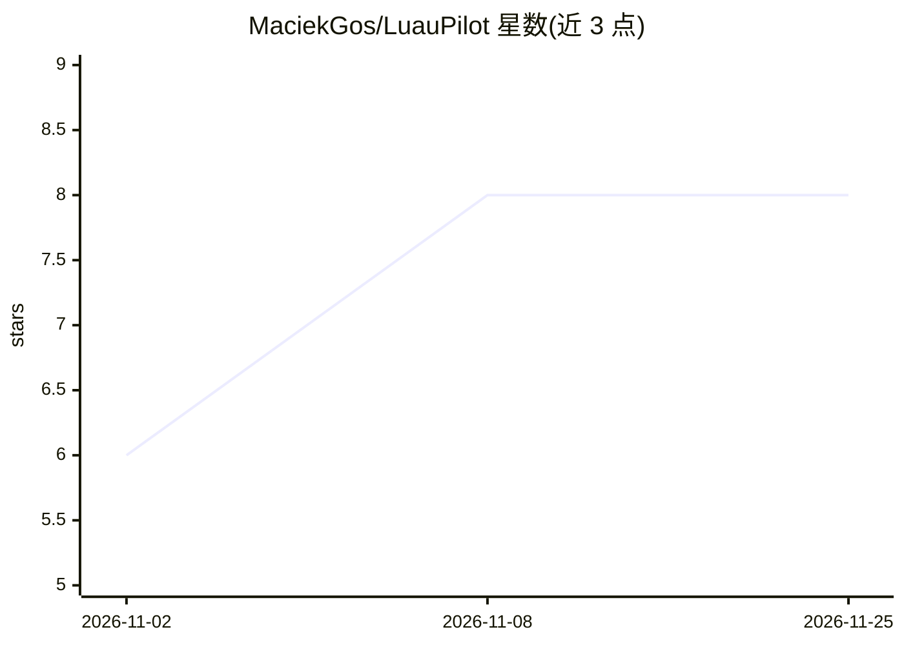

# MaciekGos/LuauPilot

⭐ 8 · JavaScript · MIT · 推送 2026-11-08 · [GitHub](https://github.com/MaciekGos/LuauPilot) · 个人维护

**把 DeepSeek 网页聊天接入 Roblox Studio 的同步工具**

由浏览器扩展、本地桥接程序与 Roblox Studio MCP 服务器组成的 Windows 工具链：扩展读取 chat.deepseek.com 页面中 AI 的指令，经本地桥传递到 Studio 的 MCP 服务器执行，结果回传聊天使 AI 持续工作。支持 Creator Store 资产检索与插入、可选 Blender 集成（经 uvx 启动 mcp-for-blender）、用户可编辑的 AI 指南文件夹。项目为 alpha 状态，作者已宣布永久停止维护，不再提供更新、修复或支持。

## 筛选速览

| 维度 | 判定 | 备注 |
|---|---|---|
| AI 角色 | `ai-ecosystem` | LLM/agent 周边工具 |
| 许可风险 | `permissive` | MIT |
| 部署形态 | `desktop` | 安装包/桌面程序 |
| 模型依赖 | locked-api |  |
| 硬件要求 | — | 无带数字的原话,不猜 |
| 安装摩擦 | `low` | 无编译、无系统依赖或容器化 |
| 成熟度 | `idea` | |

## 能力要点

- 浏览器扩展+本地桥+Studio MCP 服务器的三段式链路
- catalog_search/insert_from_creator_store 浏览并插入 Creator Store 资产
- 可选 Blender 集成（mcp-for-blender，需 uv 与 Blender）
- 可编辑的 AI 指南目录（AGENT_INSTRUCTIONS/STYLE_GUIDE 等）

## 适用场景

- 让 DeepSeek 在 Roblox Studio 中自主搭建场景与脚本
- 让 AI 检索并插入 Creator Store 免费资产
- 结合 Blender 建模与 Studio 搭建的混合工作流

## 场景标签

`编码 Agent` · 领域:编码与开发

## 证据(README 行号)

> L37: LuauPilot lets a DeepSeek chat work inside your **Roblox Studio**. A browser extension reads the AI's commands, a s
> L58: 4. Open Roblox Studio with a place and enable its MCP server (Assistant settings).

## 星数曲线

2026-11-02 6 → 2026-11-25 8（+2）

---
*卡片 v1 · prompt 1.4 · 生成 2026-11-20 · 置信度 high · 依据 README sha `95814c622820` · [字段定义](../../DATASET.md)*
