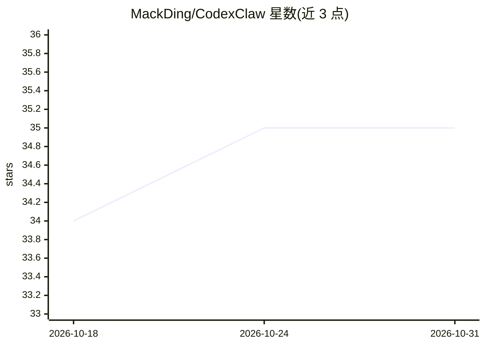

# MackDing/CodexClaw

⭐ 35 · TypeScript · MIT · 推送 2026-08-06 · [GitHub](https://github.com/MackDing/CodexClaw) · [官网](https://opc.ren) · 个人维护 · 中文 README

**通过 Telegram 远程操控 Codex 的 bot，带 MCP 路由与多代理编排**

Node.js 实现的 Telegram bot，把 Telegram 消息接入 OpenAI Codex（SDK 线程或 CLI/PTY 会话两种后端），按任务类型路由：编码任务直发 Codex，显式工具任务走子代理（GitHub skill、MCP skill），另有 cron 定时推送。提供按 chat+项目 维度的会话状态保存、工作区写冲突守卫、流式输出与推理标签渲染、零信任白名单访问控制，以及仓库内前端 dev server 的启停控制。安装需 Node.js 20+、Codex CLI 与 Telegram Bot Token。

## 筛选速览

| 维度 | 判定 | 备注 |
|---|---|---|
| AI 角色 | `ai-ecosystem` | LLM/agent 周边工具 |
| 许可风险 | `permissive` | MIT |
| 部署形态 | `library` | 以包/库形式分发 |
| 模型依赖 | — | README 未给出锁定关系 |
| 硬件要求 | — | 无带数字的原话,不猜 |
| 安装摩擦 | `low` | 无编译、无系统依赖或容器化 |
| 成熟度 | — | 结构信号不足 |

## 能力要点

- 双 Codex 后端：SDK 线程与 CLI/PTY 会话（可回退 codex exec）
- 路由层区分 Codex MCP 与 Bot MCP，避免重复调用
- 子代理控制平面（GitHub/MCP skill）+ Codex 执行平面分离
- 按 chat+project 保存会话，支持 resumeThread/PTY resume 恢复

## 适用场景

- 在手机上通过 Telegram 远程驱动 Codex 做编码任务
- 经 Telegram 管理 GitHub 提交、建仓与测试任务
- 定时触发每日摘要与推送通知

## 场景标签

`多智能体` · 领域:Agent 开发

## 证据(README 行号)

> L6: A Telegram bot that gives you remote access to `@openai/codex` through a Node.js runtime with two Codex backends: th
> L11: This bot connects Telegram to Codex and routes tasks to the right execution surface:
> L120: - **Coding requests** are sent directly to Codex (SDK or CLI backend; Codex can use its own MCP stack)

## 星数曲线

2026-10-18 34 → 2026-10-31 35（+1）

---
*卡片 v1 · prompt 1.4 · 生成 2026-10-25 · 置信度 high · 依据 README sha `ef0f637cd134` · [字段定义](../../DATASET.md)*
