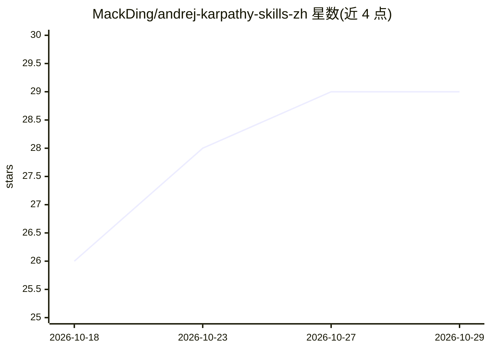

# MackDing/andrej-karpathy-skills-zh

⭐ 29 · 推送 2026-05-21 · [GitHub](https://github.com/MackDing/andrej-karpathy-skills-zh) · 个人维护 · 中文 README

**Karpathy 编码准则中文版：AI 编程助手的规则模板**

把 Andrej Karpathy 对 LLM 编码陷阱的观察整理为四条可执行原则（编码前先思考、简洁优先、精准改动、目标驱动执行），以 CLAUDE.md、AGENTS.md、Cursor Rules 与 Claude Code Skill 文件形式提供，供中文开发者在 Claude Code、Codex、Cursor、Cline、Windsurf、Aider 等 AI 编程助手中作为项目级规则使用。提供 Claude Code 插件安装与 curl 下载、文件复制三种接入方式，内容为规则文本，不含代码实现。

## 筛选速览

| 维度 | 判定 | 备注 |
|---|---|---|
| AI 角色 | `ai-knowledge` | 知识聚合/清单类 |
| 许可风险 | `none` | — |
| 部署形态 | `None` |  |
| 模型依赖 | — | README 未给出锁定关系 |
| 硬件要求 | — | 无带数字的原话,不猜 |
| 安装摩擦 | `low` | 无编译、无系统依赖或容器化 |
| 成熟度 | — | 结构信号不足 |

## 能力要点

- 四条准则：先思考、简洁优先、精准改动、目标驱动执行
- 覆盖 CLAUDE.md / AGENTS.md / Cursor Rules / Claude Code Skill 四种格式
- 支持 Claude Code 插件市场一键安装
- 附错误示例与正确示例对比（EXAMPLES.md）

## 适用场景

- 给 Claude Code / Codex / Cursor 项目配置中文编码规则
- 减少 AI 助手擅自假设、过度工程化和无关改动
- 团队沉淀项目级 AI 编程规范

## 场景标签

`提示工程` · 领域:Agent 开发

## 证据(README 行号)

> L3: 面向中文开发者的 **Claude Code、Codex、Cursor、AI Agent 编程行为准则**。本仓库把 Andrej Karpathy 对 LLM 编码问题的观察整理成可直接使用的 `CLAUDE.md`、`AGENT
> L9: - 使用 Claude Code、Codex、Cursor、Cline、Windsurf、Aider 或其他 AI 编程助手的开发者。

## 星数曲线

2026-10-18 26 → 2026-10-29 29（+3）

---
*卡片 v1 · prompt 1.4 · 生成 2026-10-26 · 置信度 high · 依据 README sha `5468c798b437` · [字段定义](../../DATASET.md)*
