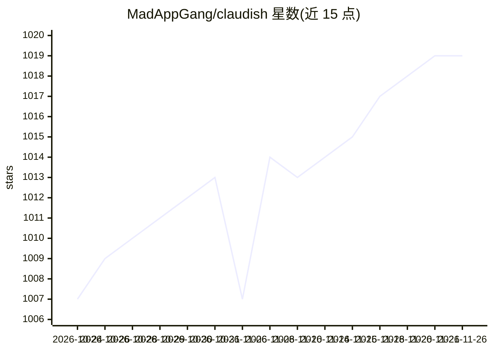

# MadAppGang/claudish

⭐ 1,019 · TypeScript · 推送 2026-11-25 · [GitHub](https://github.com/MadAppGang/claudish) · [官网](https://claudish.com) · 组织维护

**让 Claude Code 调用任意模型的本地代理 CLI**

一个 CLI 工具，通过在本地启动 Anthropic API 兼容代理服务器，使 Claude Code 能使用其他 AI 模型运行。支持通过 OpenRouter 接入 580+ 模型，以及 Gemini、OpenAI、Kimi、GLM、MiniMax 等云端与 Ollama、LM Studio、vLLM、MLX 等本地后端；支持用已有订阅（ChatGPT Plus、Gemini Advanced 等）OAuth 登录而无需 API key。要求预先安装 Claude Code CLI 并至少配置一个 provider 的 key 或本地模型。提供 npm 安装、npx 免安装与源码构建方式。

## 筛选速览

| 维度 | 判定 | 备注 |
|---|---|---|
| AI 角色 | `ai-ecosystem` | LLM/agent 周边工具 |
| 许可风险 | `none` | — |
| 部署形态 | `library` | 以包/库形式分发 |
| 模型依赖 | local-ok | 支持本地模型 |
| 硬件要求 | — | 无带数字的原话,不猜 |
| 安装摩擦 | `low` | 无编译、无系统依赖或容器化 |
| 成熟度 | — | 结构信号不足 |

## 能力要点

- 本地 Anthropic API 兼容代理，支持 provider@model 路由语法
- 支持已有订阅 OAuth 登录（claudish login）与 BYOK 模式
- 支持本地模型后端（Ollama/LM Studio/vLLM/MLX），代码不离开本机
- 提供 MCP server 模式、成本追踪与 AI agent 子代理使用指南

## 适用场景

- 用已有的 ChatGPT Plus 或 Gemini 订阅驱动 Claude Code
- 通过本地 Ollama/vLLM 模型离线运行编码代理
- 在一个会话中切换多个 provider 的模型
- AI agent 以子代理方式委托外部模型执行任务

## 场景标签

`编码 Agent` `模型网关` · 领域:Agent 开发

## 证据(README 行号)

> L13: **Claudish** (Claude-ish) is a CLI tool that allows you to run Claude Code with any AI model by proxying requests t
> L15: **Supported Providers:**
> L17: - **Local:** Ollama, LM Studio, vLLM, MLX

## 星数曲线

2026-10-24 1,007 → 2026-11-26 1,019（+12）

---
*卡片 v1 · prompt 1.4 · 生成 2026-11-24 · 置信度 high · 依据 README sha `5b4c64b2b0fa` · [字段定义](../../DATASET.md)*
