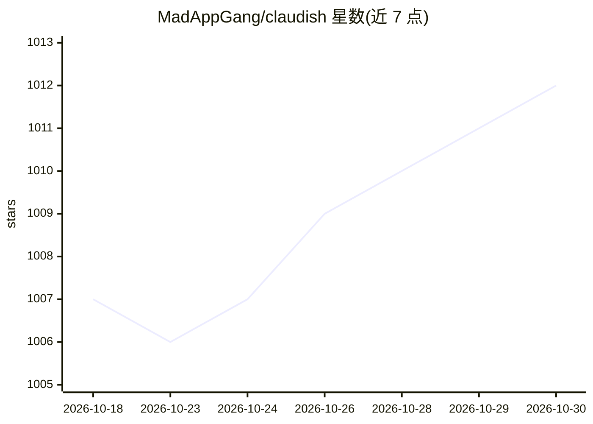

# MadAppGang/claudish

⭐ 1,012 · TypeScript · 推送 2026-10-29 · [GitHub](https://github.com/MadAppGang/claudish) · [官网](https://claudish.com) · 组织维护

**让 Claude Code 接入任意 AI 模型的本地代理 CLI 工具**

Node.js/Bun 的 CLI 工具，通过本地 Anthropic API 兼容代理服务器，让 Claude Code 使用其他提供商的模型：云端支持 OpenRouter（580+ 模型）、Gemini、OpenAI、Kimi、GLM、MiniMax 等，本地支持 Ollama、LM Studio、vLLM、MLX，含 BYOK、订阅 OAuth 登录、按角色（Opus/Sonnet/Haiku）分配模型、成本追踪与 MCP 服务器模式。前提是本机已安装 Claude Code CLI，并持有至少一个 API key 或本地模型。支持 npx/bunx 免安装运行、shell 脚本与源码安装。

## 筛选速览

| 维度 | 判定 | 备注 |
|---|---|---|
| AI 角色 | `ai-ecosystem` | LLM/agent 周边工具 |
| 许可风险 | `none` | — |
| 部署形态 | `library` | 以包/库形式分发 |
| 模型依赖 | local-ok | 支持本地模型 |
| 硬件要求 | — | 无带数字的原话,不猜 |
| 安装摩擦 | `low` | 无编译、无系统依赖或容器化 |
| 成熟度 | — | 结构信号不足 |

## 能力要点

- 本地 Anthropic API 兼容代理，将请求路由至 580+ OpenRouter 模型及直连厂商
- 本地运行时支持 Ollama/LM Studio/vLLM/MLX，可完全离线
- provider@model 路由语法与按角色（Opus/Sonnet/Haiku/subagent）分配不同模型
- 支持订阅 OAuth 登录（ChatGPT Plus、Kimi、GLM 等计划）与成本追踪

## 适用场景

- 用已付费的订阅或 API key 在 Claude Code 中运行非 Anthropic 模型
- 通过 Ollama 等本地模型让代码完全不离机地使用 Claude Code 界面
- 在 Claude Code 中按任务角色混用不同提供商的模型

## 场景标签

`模型网关` · 领域:Agent 开发

## 证据(README 行号)

> L13: **Claudish** (Claude-ish) is a CLI tool that allows you to run Claude Code with any AI model by proxying requests t
> L17: - **Local:** Ollama, LM Studio, vLLM, MLX
> L59: - ✅ **Local model support** - Ollama, LM Studio, vLLM, MLX with `ollama@`, `lmstudio@` syntax and concurrency contr

## 星数曲线

2026-10-18 1,007 → 2026-10-30 1,012（+5）

---
*卡片 v1 · prompt 1.4 · 生成 2026-10-21 · 置信度 high · 依据 README sha `7c98b74d40f1` · [字段定义](../../DATASET.md)*
