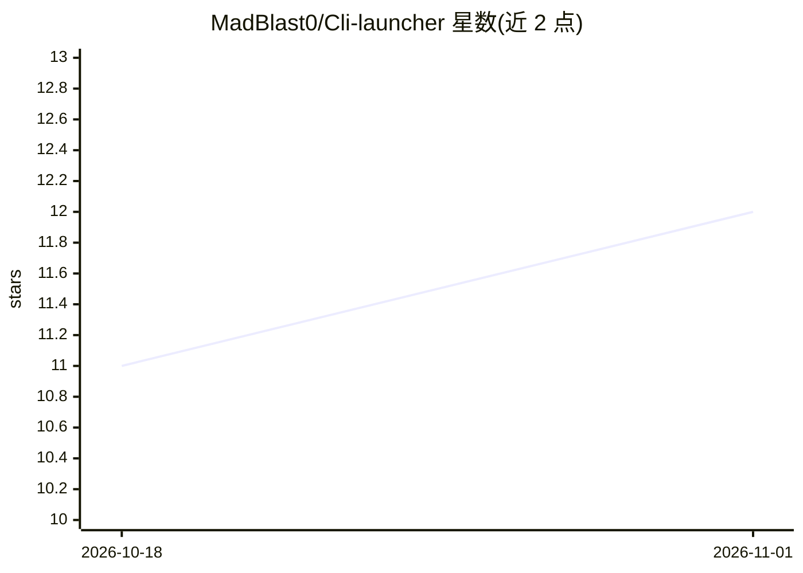

# MadBlast0/Cli-launcher

⭐ 12 · TypeScript · MIT · 推送 2026-08-22 · [GitHub](https://github.com/MadBlast0/Cli-launcher) · [官网](https://clilauncher.veyl.in) · 个人维护

**管理 34 种终端 AI 编码代理的跨平台桌面启动器**

基于 Electron + React + TypeScript 的桌面应用，用于安装、更新、卸载和启动 34 种终端 AI 编码 CLI（Claude Code、Gemini CLI、Aider、Codex 等）。为每个 CLI 按平台动态生成安装脚本，检测并自动安装缺失的 Node.js/Python 运行时，支持 1–9 个多终端实例启动、按 npm/pip 检测版本更新、收藏与拖拽排序。提供 YOLO 模式自动附加跳过权限确认的参数。以原生安装包（msi/exe/dmg/AppImage/deb/rpm 等）分发，macOS 与 Linux 有一行脚本安装器；发布版本未代码签名，macOS 应用内自动更新不可用。

## 筛选速览

| 维度 | 判定 | 备注 |
|---|---|---|
| AI 角色 | `ai-ecosystem` | LLM/agent 周边工具 |
| 许可风险 | `permissive` | MIT |
| 部署形态 | `desktop` | 安装包/桌面程序 |
| 模型依赖 | — | README 未给出锁定关系 |
| 硬件要求 | — | 无带数字的原话,不猜 |
| 安装摩擦 | `low` | 无编译、无系统依赖或容器化 |
| 成熟度 | — | 结构信号不足 |

## 能力要点

- 统一管理 34 种终端 AI 编码 CLI 的安装/更新/卸载/修复
- 按平台动态生成各 CLI 安装脚本，检测并自动补装 Node.js/Python 运行时
- 多终端启动（1–9 实例），支持 cmd/PowerShell/iTerm/Warp/GNOME Terminal 等多种终端
- 发布版本未代码签名，macOS 应用内自动更新不可用，需手动下载新版本

## 适用场景

- 在一个面板里安装和管理多个 AI 编码 CLI，避免逐个配置
- 为不同项目目录快速启动多个终端 AI 代理实例
- 批量检测并更新已安装的 AI CLI 到新版本

## 场景标签

 · 领域:开发工具/桌面应用

## 证据(README 行号)

> L3: Cross-platform desktop launcher for AI coding CLIs. Install, update, uninstall, and launch 34 terminal AI agents — a
> L63: - **Install / Update / Uninstall / Repair** — per-CLI actions with real-time progress feedback. Each CLI gets its o

## 星数曲线

2026-10-18 11 → 2026-11-01 12（+1）

---
*卡片 v1 · prompt 1.4 · 生成 2026-11-01 · 置信度 mid · 依据 README sha `824f29b39d0e` · [字段定义](../../DATASET.md)*
