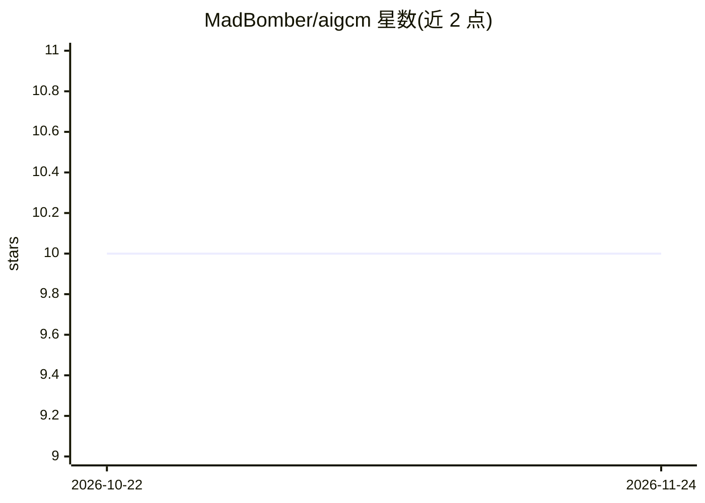

# MadBomber/aigcm

⭐ 10 · Ruby · MIT · 推送 2026-11-18 · [GitHub](https://github.com/MadBomber/aigcm) · 个人维护

**面向 git 用户的 AI 提交信息生成命令行工具**

aigcm 是以 Ruby gem 形式发布的 CLI 工具：读取 git diff，调用 LLM 生成符合规范的 commit message。支持通过 --model/--provider 指定模型与提供方，默认使用 OpenAI 的 gpt-4o-mini；可用 COMMITS.md 或 --style 指定风格指南；私有仓库场景下默认拒绝外部提供方，需 --force-external 或本地提供方绕过（依赖 gh 命令判断仓库是否私有）；支持 --dry 试运行并把消息写入 .aigcm_msg 以便嵌入自定义工作流。

## 筛选速览

| 维度 | 判定 | 备注 |
|---|---|---|
| AI 角色 | `ai-native` | 本体是模型或模型工具 |
| 许可风险 | `permissive` | MIT |
| 部署形态 | `None` |  |
| 模型依赖 | local-ok | 支持本地模型 |
| 硬件要求 | — | 无带数字的原话,不猜 |
| 安装摩擦 | `low` | 无编译、无系统依赖或容器化 |
| 成熟度 | — | 结构信号不足 |

## 能力要点

- 基于 git diff 与附加上下文（-c）生成提交信息
- 私有仓库默认禁用外部提供方的安全检查机制
- COMMITS.md 风格指南可定制并可在多项目间复用
- --dry 试运行结果保存至 .aigcm_msg，1 分钟内复用

## 适用场景

- 为日常 git 提交自动生成规范的 commit message
- 私有仓库中用本地 ollama 模型避免 diff 外发
- 团队用统一风格指南保持多项目提交信息一致

## 场景标签

 · 领域:开发者工具/git 工作流

## 证据(README 行号)

> L11: **aigcm** is a Ruby gem designed to generate high-quality commit messages for git diffs. It leverages AI to analyze
> L15: - **Automatic Commit Message Generation**: Automatically generate commit messages based on code diffs.
> L87: If you do not specify a model `aigcm` attempts to use `gpt-4o-mini` from OpenAI. If you want to use a different mod

## 星数曲线

2026-10-22 10 → 2026-11-24 10（+0）

---
*卡片 v1 · prompt 1.4 · 生成 2026-11-20 · 置信度 high · 依据 README sha `66e05604a19b` · [字段定义](../../DATASET.md)*
