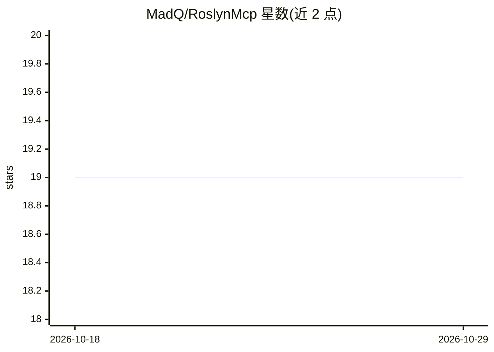

# MadQ/RoslynMcp

⭐ 19 · C# · MIT · 推送 2026-10-12 · [GitHub](https://github.com/MadQ/RoslynMcp) · 个人维护

**给 AI 编码代理提供 Roslyn 编译器级 C# 代码理解的 MCP 服务器**

一个 Model Context Protocol 服务器，让 AI 编码 agent 通过进程内持续更新的 Roslyn 编译获得 C# 语义能力：类型解析、跨文件引用查找、语义重命名、诊断检查等 45 个 MCP 工具（43 公开 + 2 调试用），替代文本匹配式的 grep/正则方案。支持 Claude Code、GitHub Copilot、Cursor 等任意 MCP 兼容客户端。安装提供 NuGet dotnet tool（需 .NET 10/11 SDK）、预编译发布包（无需 SDK）与源码构建三种途径，附带 `setup` 命令自动写入客户端配置和浏览器日志查看器。项目自标为 Beta，pre-1.0 曾发生包名破坏性变更（改名为 MadQ.RoslynMcp）。以用户权限运行，官方建议仅在可信 agent 与自有项目上使用。

## 筛选速览

| 维度 | 判定 | 备注 |
|---|---|---|
| AI 角色 | `ai-ecosystem` | LLM/agent 周边工具 |
| 许可风险 | `permissive` | MIT |
| 部署形态 | `desktop` | 安装包/桌面程序 |
| 模型依赖 | — | README 未给出锁定关系 |
| 硬件要求 | — | 无带数字的原话,不猜 |
| 安装摩擦 | `high` | 编译与系统依赖俱全 |
| 成熟度 | `idea` | |

## 能力要点

- 45 个 MCP 工具覆盖发现、导航、读取、编辑、重构、构建、诊断七类操作
- 进程内维护增量更新的 Roslyn 编译，语义级引用查找与跨解决方案重命名
- roslyn_get_member_body 按方法/成员粒度返回源码以减少 token 消耗
- madq-roslynmcp setup 自动检测 MCP 客户端并写入配置

## 适用场景

- 让 Claude Code / Copilot 等 agent 精确查找符号引用而非全文搜索
- 跨多项目的 C# 语义重命名与代码修复（预览-确认两段式）
- 在不离开进程的情况下获取编译诊断与构建验证

## 场景标签

 · 领域:软件开发/代码智能

## 证据(README 行号)

> L11: RoslynMcp is a Model Context Protocol server that gives AI coding agents real Roslyn compiler semantics: type resol
> L20: Works with any MCP-compatible client: Claude Code, GitHub Copilot, Claude Desktop, Cline, Cursor, Windsurf, Roo Cod

## 星数曲线

2026-10-18 19 → 2026-10-29 19（+0）

---
*卡片 v1 · prompt 1.4 · 生成 2026-10-29 · 置信度 high · 依据 README sha `5fe103488e68` · [字段定义](../../DATASET.md)*
