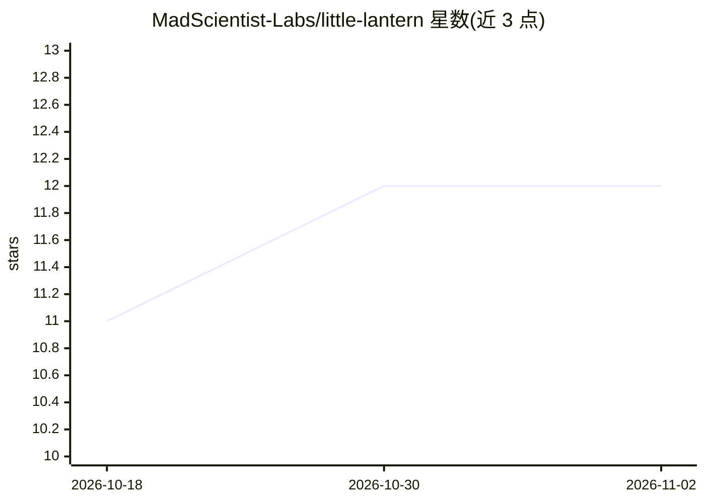

# MadScientist-Labs/little-lantern

⭐ 12 · JavaScript · CC0-1.0 · 推送 2026-07-25 · [GitHub](https://github.com/MadScientist-Labs/little-lantern) · 个人维护

**本地自托管的 AI 伴侣聊天应用，自带 API key 使用**

纯 HTML/CSS/vanilla JS 单页应用加一个基于 Python 标准库的本地服务器（start.py），通过 127.0.0.1:3000 在浏览器中运行。用户自带 API key 接入 OpenAI、Claude、Gemini、Mistral、Nous、OpenRouter 六个提供商。提供伴侣角色卡、系统提示词、Memory Books、Desk Notes、工具调用（计算器/网页搜索/文件读写/图像生成）与 JSON 备份。数据全部存于浏览器 localStorage，无账户、无遥测。许可证为 CC0 公共领域，由个人维护。不含免费模型访问，本地不运行模型。

## 筛选速览

| 维度 | 判定 | 备注 |
|---|---|---|
| AI 角色 | `ai-native` | 本体是模型或模型工具 |
| 许可风险 | `viral` | CC0-1.0 |
| 部署形态 | `library` | 以包/库形式分发 |
| 模型依赖 | locked-api |  |
| 硬件要求 | — | 无带数字的原话,不猜 |
| 安装摩擦 | `low` | 无编译、无系统依赖或容器化 |
| 成熟度 | — | 结构信号不足 |

## 能力要点

- 六个 API 提供商，用户自带 key，可随时切换
- 数据全部存于浏览器 localStorage，无后端服务器
- 无构建步骤的 vanilla JS 单页应用 + Python 标准库本地服务器
- 伴侣系统含角色卡、Memory Books、Desk Notes 与工具调用

## 适用场景

- 在本地私密地运行自己的 AI 伴侣角色
- 角色扮演、创作写作时自定义系统提示词与记忆
- 不经过中间服务器直接用自己的 API key 与模型对话

## 场景标签

`聊天机器人` `图像生成` · 领域:对话与助手

## 证据(README 行号)

> L3: Little Lantern is free, open-source AI companion software: a cosy, private desktop app that runs on your own compute
> L59: - **Six providers, your key** — OpenAI, Claude, Gemini, Mistral, Nous, OpenRouter. Swap any time.
> L90: **What it is.** A single-page app in plain **HTML / CSS / vanilla JS** — no framework, no bundler, no npm, no build

## 星数曲线

2026-10-18 11 → 2026-11-02 12（+1）

---
*卡片 v1 · prompt 1.4 · 生成 2026-11-01 · 置信度 mid · 依据 README sha `90b9b5d4e268` · [字段定义](../../DATASET.md)*
