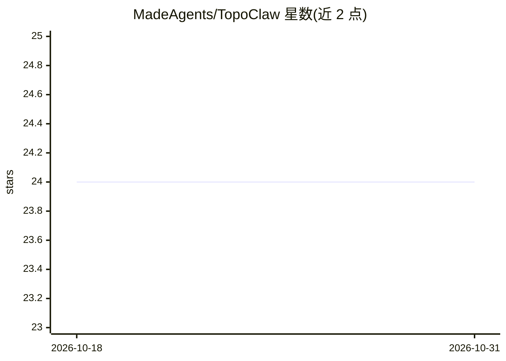

# MadeAgents/TopoClaw

⭐ 24 · Kotlin · Apache-2.0 · 推送 2026-05-12 · [GitHub](https://github.com/MadeAgents/TopoClaw) · [官网](https://madeagents.ai/innovation/topoclaw/) · 组织维护 · 中文 README

**跨 Android/Windows 的开源跨设备个人 AI 助手**

由 TopoMobile 与 TopoDesktop 组成的开源跨设备 AI agent 系统，面向个人用户：手机与电脑组成统一执行面，支持 GUI 自动化（mobile-use/computer-use）、DeepLink、代码与工具调用，任务可跨设备编排与并行。具备社交协作（以用户身份建群、协商、代回复）、通知监听与日程冲突检测的主动感知推进能力。安全上提供三级文件权限、工作区隔离与命令审计。安装通过第三方构建的 APK/EXE 安装包并自部署中继服务，模型分 Chat 与多模态 GUI 两类分别配置；移动端 GUI 任务需授予无障碍、截屏等权限。

## 筛选速览

| 维度 | 判定 | 备注 |
|---|---|---|
| AI 角色 | `ai-native` | 本体是模型或模型工具 |
| 许可风险 | `permissive` | Apache-2.0 |
| 部署形态 | `library` | 以包/库形式分发 |
| 模型依赖 | — | README 未给出锁定关系 |
| 硬件要求 | — | 无带数字的原话,不猜 |
| 安装摩擦 | `low` | 无编译、无系统依赖或容器化 |
| 成熟度 | — | 结构信号不足 |

## 能力要点

- 手机与电脑统一执行面，任务跨设备分解、并行与串联
- 社交协作：建群、代用户协商与回复，支持多用户多助手三种群编排模式
- 主动感知：监听通知、检测日程冲突、主动汇报关键结论
- 三级文件权限+工作区隔离+命令执行审计的安全架构

## 适用场景

- 让助手跨手机和电脑完成多步骤任务，如读电脑上的 PDF 再用手机发短信
- 外出时让助手代管群消息并在关键决策时提醒我
- 基于技能社区与助手市场扩展个人助手能力

## 场景标签

`GUI 自动化` `AI 助手` · 领域:效率与自动化

## 证据(README 行号)

> L19: TopoClaw is an open-source cross-device AI agent system for Android and Windows. It combines mobile-use, computer-u
> L21: TopoClaw is your **AI digital assistant**. It's not just a chatbot — it's an assistant that can **operate your comp

## 星数曲线

2026-10-18 24 → 2026-10-31 24（+0）

---
*卡片 v1 · prompt 1.4 · 生成 2026-10-27 · 置信度 mid · 依据 README sha `51056ede187f` · [字段定义](../../DATASET.md)*
