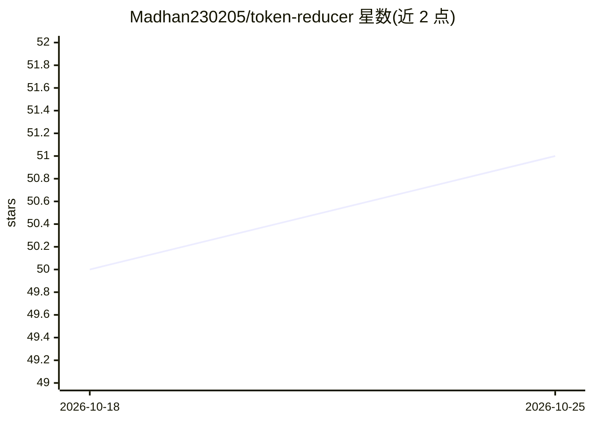

# Madhan230205/token-reducer

⭐ 52 · Python · MIT · 推送 2026-05-02 · [GitHub](https://github.com/Madhan230205/token-reducer) · [官网](https://github.com/Madhan230205/token-reducer) · 个人维护

**Claude Code 插件：本地压缩代码库上下文以降低 token 消耗**

面向 Claude Code 用户的本地优先上下文压缩插件：对代码库做 Tree-sitter AST 分块与索引，查询时经 BM25（SQLite FTS5）与向量检索混合召回、重排，再用 TextRank 与查询相关性评分压缩为限定词数的上下文包，宣称可将 token 用量降低 90-98%。全部流程本地运行，不调用外部 API；不装 ML 库时可退回 hash 嵌入与正则分块的零依赖模式。支持 /plugin 命令、git clone 与独立 Python 脚本三种安装使用方式。

## 筛选速览

| 维度 | 判定 | 备注 |
|---|---|---|
| AI 角色 | `ai-ecosystem` | LLM/agent 周边工具 |
| 许可风险 | `permissive` | MIT |
| 部署形态 | `library` | 以包/库形式分发 |
| 模型依赖 | locked-api |  |
| 硬件要求 | — | 无带数字的原话,不猜 |
| 安装摩擦 | `low` | 无编译、无系统依赖或容器化 |
| 成熟度 | — | 结构信号不足 |

## 能力要点

- BM25 + 向量混合检索，SQLite FTS5 + HNSW 索引
- Tree-sitter AST 分块，支持 Python/TS/Go/Rust/Java 等语言
- TextRank 压缩与查询相关性评分，输出限定词数的上下文包
- 零依赖模式：hash 嵌入 + 正则分块，无需 ML 库

## 适用场景

- 降低 Claude Code 在大型代码库上的 token 开销
- 为 AI 编码助手提供语义相关的压缩上下文
- 不依赖外部 API 的本地代码检索与摘要

## 场景标签

`RAG` `语义搜索` · 领域:知识与检索

## 证据(README 行号)

> L5: Claude Code Plugin
> L27: - Reduces tokens by 90-98% while preserving semantic relevance
> L28: - Runs entirely locally — no API calls, no data leaving your machine

## 星数曲线

2026-10-18 50 → 2026-10-25 51（+1）

---
*卡片 v1 · prompt 1.4 · 生成 2026-10-24 · 置信度 mid · 依据 README sha `2597d198b1d9` · [字段定义](../../DATASET.md)*
