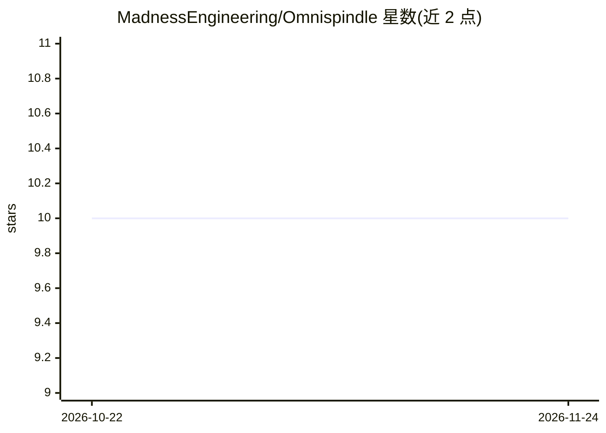

# MadnessEngineering/Omnispindle

⭐ 10 · Python · 推送 2026-11-19 · [GitHub](https://github.com/MadnessEngineering/Omnispindle) · [官网](https://madnessinteractive.cc/) · 组织维护

**为 AI agent 提供任务管理与知识沉淀的 FastMCP 服务器**

基于 Python FastMCP 的 MCP 服务器，提供 38 个工具，让 AI agent 完成待办增删改查、经验教训记录、会话谱系追踪与 Quest 多步目标管理；支持向量语义搜索与上下文打包调用。通过 pip 安装，可零配置接入 Claude Desktop，首次调用走 Auth0 设备流登录，数据按用户隔离。运行模式分 api/hybrid/local/auto，本地模式依赖 MongoDB；README 声明含团队自有 Auth0 配置，直接部署需自行替换凭据。

## 筛选速览

| 维度 | 判定 | 备注 |
|---|---|---|
| AI 角色 | `ai-ecosystem` | LLM/agent 周边工具 |
| 许可风险 | `none` | — |
| 部署形态 | `library` | 以包/库形式分发 |
| 模型依赖 | — | README 未给出锁定关系 |
| 硬件要求 | — | 无带数字的原话,不猜 |
| 安装摩擦 | `low` | 无编译、无系统依赖或容器化 |
| 成熟度 | — | 结构信号不足 |

## 能力要点

- 38 个 MCP 工具，分 7 类，可用 OMNISPINDLE_TOOL_LOADOUT 按 token 预算裁剪
- 知识教训支持正则、文本与向量嵌入三种检索（find_relevant/preflight_rag）
- 会话可 fork/spawn 并追踪完整谱系树，Quest 系统组织多步目标
- Auth0 设备流零配置登录，数据按用户在数据库层隔离

## 适用场景

- 让 Claude Desktop 等 MCP 客户端代为管理跨项目待办任务
- 在多 agent 协作开发中沉淀可检索的经验教训
- 追踪 AI 工作会话的派生谱系与项目进度

## 场景标签

`Agent 记忆` · 领域:Agent 开发

## 证据(README 行号)

> L5: Omnispindle is the coordination spine of the Madness Interactive ecosystem — a Python FastMCP server with 38 tools t
> L26: - `omnispindle-stdio` — MCP stdio server for Claude Desktop
> L144: - **`local`** — Direct MongoDB connections only. Good for offline development.

## 星数曲线

2026-10-22 10 → 2026-11-24 10（+0）

---
*卡片 v1 · prompt 1.4 · 生成 2026-11-20 · 置信度 mid · 依据 README sha `fab5efc45554` · [字段定义](../../DATASET.md)*
