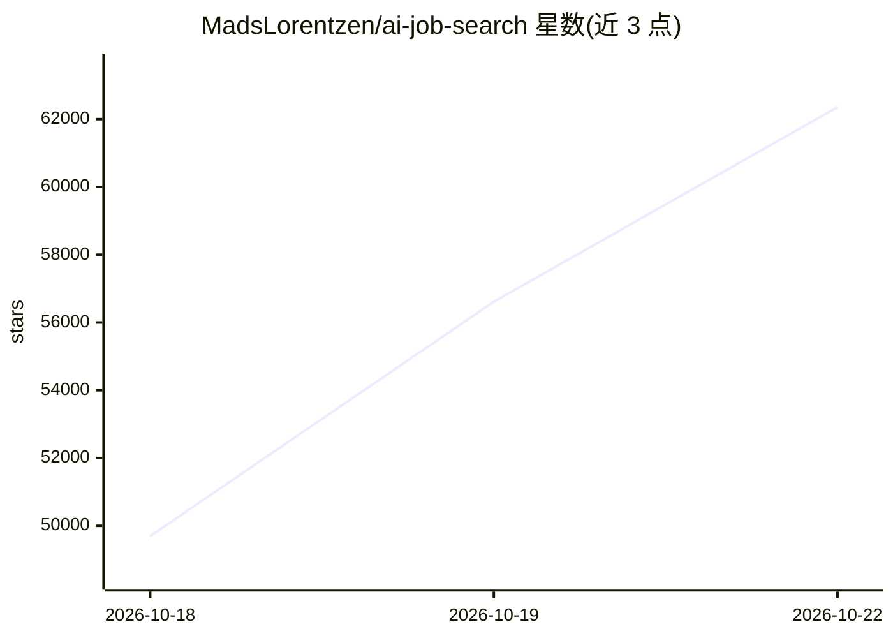

# MadsLorentzen/ai-job-search

⭐ 62,353 · Python · MIT · 推送 2026-10-21 · [GitHub](https://github.com/MadsLorentzen/ai-job-search) · 个人维护

**基于 Claude Code 的本地求职申请框架：评估岗位、定制简历、写求职信**

在用户本机运行的 AI 求职申请工作流，构建于 Claude Code CLI 之上：/setup 建立个人档案，/scrape 抓取并按匹配度排序职位（内置丹麦求职门户，可自行替换），/apply 对岗位做匹配评估、起草 LaTeX 简历与求职信并经第二个 agent 审查修订，另有 /interview 面试准备、/outcome 结果跟踪等十余个命令。核心工作流与语言/国家无关，门户搜索技能面向丹麦市场。需 Claude Pro/Max/Team 订阅或 Anthropic API 额度，外加 Python 3.10+、Bun、LaTeX 发行版。以 fork/克隆仓库方式使用，作者声明与 Anthropic 无关。

## 筛选速览

| 维度 | 判定 | 备注 |
|---|---|---|
| AI 角色 | `ai-native` | 本体是模型或模型工具 |
| 许可风险 | `permissive` | MIT |
| 部署形态 | `library` | 以包/库形式分发 |
| 模型依赖 | locked-api |  |
| 硬件要求 | — | 无带数字的原话,不猜 |
| 安装摩擦 | `low` | 无编译、无系统依赖或容器化 |
| 成熟度 | — | 结构信号不足 |

## 动量与使用信号

- 维护:`active` — 距上次 push 2.6 天,年发版 10,78 位贡献者
- 涨星:近 1 天 **+2,054**(自 20261016 起算)
- 安装:pypi 包 `pypdf` 月下载 125,991,621
- 平台:WINDOWS / MACOS · 协议:MCP

## 能力要点

- /apply 起草-审查工作流：评估匹配、生成简历与求职信并二次修订
- 招聘贴文按不可信输入处理，先过确定性完整性检查（隐藏文本/隐藏链接等）
- 内置丹麦求职门户抓取技能，/add-portal 可为本地市场生成新门户技能
- /interview、/rank、/html-report 等十余个扩展命令覆盖面试准备与申请漏斗管理

## 适用场景

- 批量抓取招聘门户并按与个人档案的匹配度排序
- 针对单个岗位自动定制简历和求职信
- 面试前基于已投材料生成针对性准备包
- 跟踪申请状态并生成求职漏斗看板

## 场景标签

`网页抓取` `AI 写作` · 领域:效率与自动化

## 证据(README 行号)

> L11: An AI-powered job application framework built on Claude Code. Fork it, fill in your profile, and let Claude evaluat
> L34: A structured workflow that turns Claude Code into a full-stack job application assistant. The core workflow (self-p
> L47: - Claude Code (CLI). Claude Code has no free tier: you need a Claude Pro/Max/Team subscription or Anthropic API cre

## 星数曲线

2026-10-18 49,696 → 2026-10-22 62,353（+12,657）

---
*卡片 v1 · prompt 1.4 · 生成 2026-10-20 · 置信度 mid · 依据 README sha `d9ed9f67d873` · [字段定义](../../DATASET.md)*
