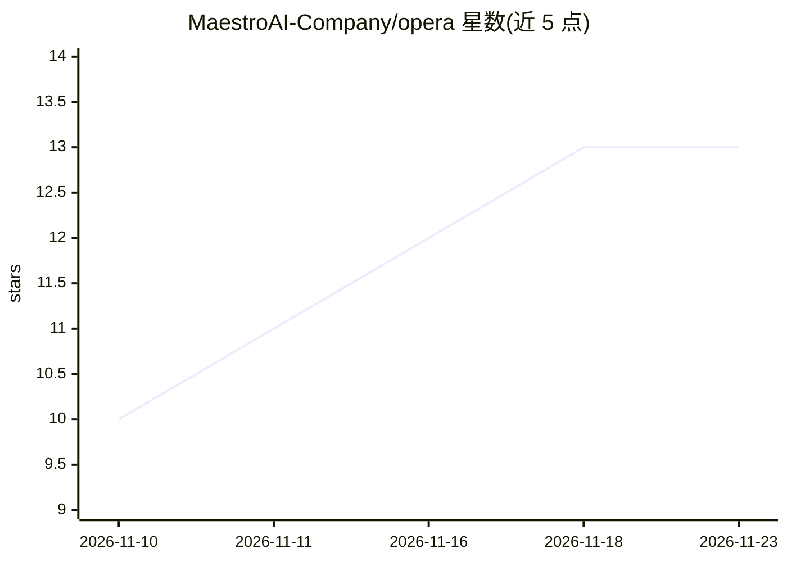

# MaestroAI-Company/opera

⭐ 13 · TypeScript · AGPL-3.0 · 推送 2026-11-22 · [GitHub](https://github.com/MaestroAI-Company/opera) · [官网](https://maestroai.company/opera/) · 组织维护

**隐私优先的开源 AI 助手，支持手机与桌面多端本地运行**

Opera 是一个隐私优先的跨平台 AI 助手应用，内置助手 Maestro，覆盖 Android、Windows、macOS 和 Linux。模型可在设备本地（Android AICore 的 Gemini Nano、LiteRT-LM 运行 Hugging Face 模型）、自建 Ollama 服务器或任意 OpenAI 兼容端点上运行，无账户要求。功能包括工具调用、MCP 服务器接入、附件读取、语音输入与朗读、屏幕文字选择与物体检测、多设备通过 Sampler Hub 配对共享模型与对话、Nextcloud/Google Drive 加密同步、隐身模式。移动/Web 端基于 Expo/React Native，桌面端基于 Tauri 2。语言支持英语和法语。

## 筛选速览

| 维度 | 判定 | 备注 |
|---|---|---|
| AI 角色 | `ai-native` | 本体是模型或模型工具 |
| 许可风险 | `viral` | AGPL-3.0 |
| 部署形态 | `desktop` | 安装包/桌面程序 |
| 模型依赖 | local-ok | 支持本地模型 |
| 硬件要求 | — | 无带数字的原话,不猜 |
| 安装摩擦 | `low` | 无编译、无系统依赖或容器化 |
| 成熟度 | — | 结构信号不足 |

## 能力要点

- 多模型来源：内置 AICore（Gemini Nano）、本地 LiteRT-LM 模型、Ollama、OpenAI 兼容端点
- MCP 服务器接入，OAuth 感知，工具可在聊天中 @提及
- Sampler Hub QR 配对实现多设备共享模型与语音
- 屏幕捕获文字选择与 ExecuTorch 物体检测

## 适用场景

- 在无网络环境下在手机或电脑上本地使用 AI 助手
- 通过一个助手在手机、平板和电脑间接续对话
- 将手机设为默认系统助手，在任意应用上唤起对话

## 场景标签

`AI 助手` · 领域:对话与助手

## 证据(README 行号)

> L16: Opera is a privacy-first AI assistant. Run a model on the device itself, on your own Ollama server, or on any OpenA
> L45: |Model providers|**Built-in** (Gemini Nano via Android AICore, or the browser's built-in model on web), **On-Device

## 星数曲线

2026-11-10 10 → 2026-11-23 13（+3）

---
*卡片 v1 · prompt 1.4 · 生成 2026-11-18 · 置信度 high · 依据 README sha `889bd602d6ad` · [字段定义](../../DATASET.md)*
