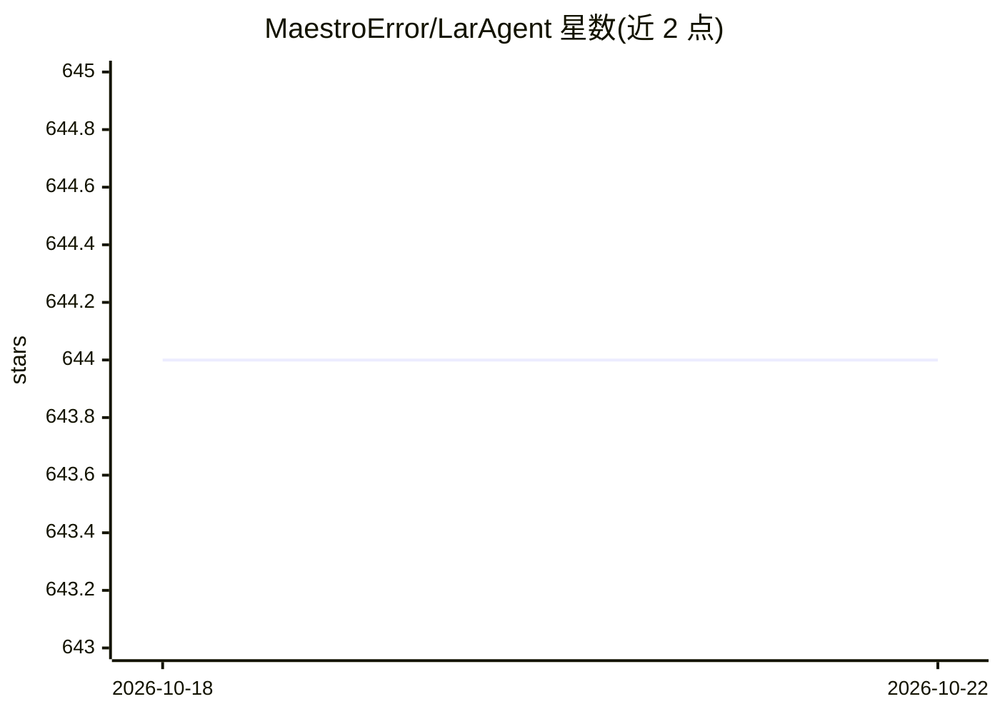

# MaestroError/LarAgent

⭐ 644 · PHP · MIT · 推送 2026-08-20 · [GitHub](https://github.com/MaestroError/LarAgent) · [官网](https://laragent.ai/) · 组织维护

**Laravel 项目的 AI Agent 开发框架**

面向 Laravel 开发者的开源 AI agent 框架，用 Eloquent 风格语法定义 agent、工具、记忆与工作流，提供 artisan 命令生成 agent 类、属性化工具定义、多模态输入、结构化输出、事件系统与 MCP server 支持。支持多 provider 配置与自动故障转移，内置 OpenAI 驱动及 Responses API 驱动，也可独立于 Laravel 使用。要求 Laravel 10+ 与 PHP 8.3+，通过 composer 安装。由 Redberry（Laravel 官方合作伙伴）支持维护。

## 筛选速览

| 维度 | 判定 | 备注 |
|---|---|---|
| AI 角色 | `ai-ecosystem` | LLM/agent 周边工具 |
| 许可风险 | `permissive` | MIT |
| 部署形态 | `None` |  |
| 模型依赖 | — | README 未给出锁定关系 |
| 硬件要求 | — | 无带数字的原话,不猜 |
| 安装摩擦 | `low` | 无编译、无系统依赖或容器化 |
| 成熟度 | — | 结构信号不足 |

## 能力要点

- Eloquent 风格 API 定义 agent、工具、记忆与多 agent 工作流
- 多 provider 支持与自动故障转移（数组按序回退）
- 内置 OpenAI 驱动与 OpenAI Responses API 驱动（支持 reasoning_effort）
- MCP server 支持与独立于 Laravel 的 standalone 用法

## 适用场景

- 在 Laravel 项目中构建带工具调用与记忆的对话 agent
- 自动化内部运营流程或为产品添加对话式体验
- 通过 OpenAI 兼容 schema 对外暴露 agent API

## 场景标签

`Agent 框架` · 领域:Agent 开发

## 证据(README 行号)

> L10:  LarAgent is an AI agent development framework for Laravel
> L21: LarAgent is an open-source framework that lets you create powerful AI agents in Laravel with minimal configuration 

## 星数曲线

2026-10-18 644 → 2026-10-22 644（+0）

---
*卡片 v1 · prompt 1.4 · 生成 2026-10-21 · 置信度 high · 依据 README sha `a598167f467a` · [字段定义](../../DATASET.md)*
