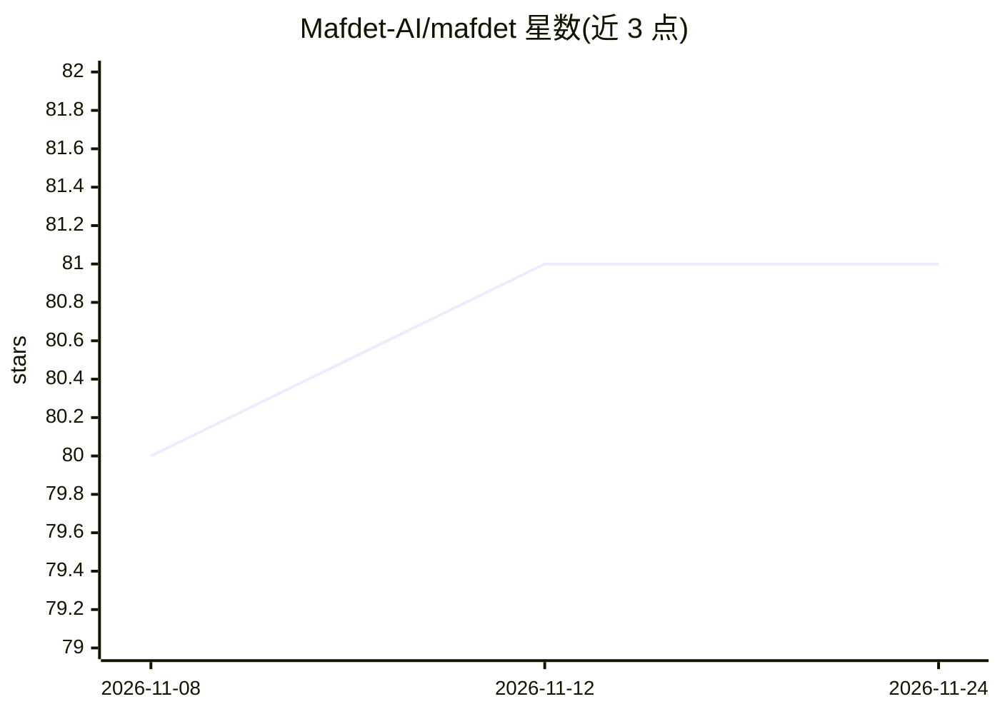

# Mafdet-AI/mafdet

⭐ 81 · Python · Apache-2.0 · 推送 2026-11-14 · [GitHub](https://github.com/Mafdet-AI/mafdet) · 个人维护

**本地 LLM 聊天应用：边打字边预读和预思考，降低回车后等待**

面向本地大模型用户的聊天应用（GUI/TUI 双形态），核心机制是利用用户打字时间提前完成 LLM 的 prefill（通过最长公共前缀增量维护 KV cache，结果与从头计算一致）和提前推理（推理笔记保留在 prompt 中，文本修改后继续）。基于 llama.cpp 运行 GGUF 模型，支持 NVIDIA CUDA、Apple Silicon Metal、AMD Vulkan 及纯 CPU；自动安装 llama.cpp 并按硬件推荐/下载模型，估算与实测误差声明在 12% 内。自述状态为 prototype；提前推理基于非最终文本，故仅在可校验答案上测量。

## 筛选速览

| 维度 | 判定 | 备注 |
|---|---|---|
| AI 角色 | `ai-native` | 本体是模型或模型工具 |
| 许可风险 | `permissive` | Apache-2.0 |
| 部署形态 | `desktop` | 安装包/桌面程序 |
| 模型依赖 | local-ok | 支持本地模型 |
| 硬件要求 | `cpu-ok` | |
| 安装摩擦 | `medium` | 含编译或系统依赖之一 |
| 成熟度 | `idea` | |

## 能力要点

- 打字期间增量维护 KV cache，prefill 在回车前完成（结果与从头计算一致）
- 推理模型（Qwen3 思考模式）在打字期间提前思考，笔记随文本修改保留
- 参考机型为 RTX 2060 6GB，另支持 Apple Silicon Metal、AMD Vulkan 与纯 CPU
- 模型目录按本机硬件给出速度/等待估算，支持任意 GGUF 与 Hugging Face 下载

## 适用场景

- 本地运行 LLM 聊天，缩短回车后到首字的等待
- 在低显存或无独显机器上使用量化 GGUF 模型
- 管理本地模型目录并按硬件选择合适模型

## 场景标签

`聊天机器人` · 领域:对话与助手

## 证据(README 行号)

> L5: MAFDET reads your message while you type it, and **starts thinking about it before you send it**.
> L19: MAFDET uses the time you spend typing for both. It **reads** your message as you write it, so the prefill is done b
> L88: The same app comes in two forms, on the same engine:

## 星数曲线

2026-11-08 80 → 2026-11-24 81（+1）

---
*卡片 v1 · prompt 1.4 · 生成 2026-11-18 · 置信度 high · 依据 README sha `a79f22647ed0` · [字段定义](../../DATASET.md)*
