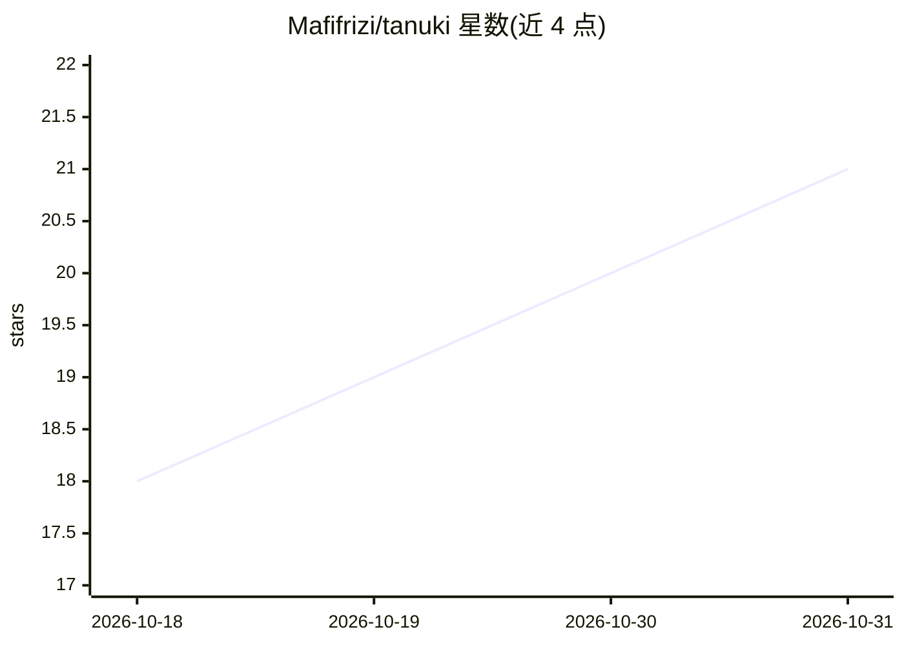

# Mafifrizi/tanuki

⭐ 21 · Python · NOASSERTION · 推送 2026-10-30 · [GitHub](https://github.com/Mafifrizi/tanuki) · 组织维护

**非特权 Linux 下的混合 Active Directory 身份运维工具**

面向无 root 权限 Linux 用户态的 Active Directory 运维与紫队工具：在纯用户空间完成 Kerberos TGT/TGS 协商（RFC 4120），支持 keytab 解析、时钟漂移内存内自愈、量化身份爆炸半径评分（0-100）与 Tier 0/1/2 分级、AD CS 模板（ESC1-ESC11）扫描、LDAP 侦察、NIST SP 800-88 内存清除。提供 Python 零依赖参考引擎与 Rust 双实现，另导出 AI agent 技能声明供 Claude Code、Cursor、Google Antigravity 等开发者工具调用。

## 筛选速览

| 维度 | 判定 | 备注 |
|---|---|---|
| AI 角色 | `ai-enhanced` | 去掉 AI 部分产品仍成立 |
| 许可风险 | `permissive` | NOASSERTION |
| 部署形态 | `library` | 以包/库形式分发 |
| 模型依赖 | — | README 未给出锁定关系 |
| 硬件要求 | — | 无带数字的原话,不猜 |
| 安装摩擦 | `low` | 无编译、无系统依赖或容器化 |
| 成熟度 | — | 结构信号不足 |

## 能力要点

- UID 1000 纯用户空间运行，零 root、零主机配置修改（不动 /etc/krb5.conf）
- Python 引擎仅依赖标准库，另有 1.8 MB 静态 musl Rust 核心
- 量化爆炸半径评分（0-100）与 Tier 0/1/2 分级，输出 PowerShell 缓解命令
- tanuki skill 导出 Claude Code / Cursor / Google Antigravity 可用的 agent 技能声明

## 适用场景

- 无 sudo 权限的 Linux 工作负载（K8s Pod、CI runner、AI agent）接入企业 AD 域认证
- 审计机器身份的特权层级与爆炸半径并生成缓解脚本
- 扫描 AD CS 证书模板的 ESC1-ESC11 配置错误

## 场景标签

`网络安全` · 领域:学习与行业

## 证据(README 行号)

> L28: **Tanuki** is an autonomous, protocol-first Active Directory operator designed specifically for unprivileged Linux 
> L221: Exports structured agent tool declarations and operational schemas for autonomous developer tools (Claude Code, Cu

## 星数曲线

2026-10-18 18 → 2026-10-31 21（+3）

---
*卡片 v1 · prompt 1.4 · 生成 2026-10-29 · 置信度 high · 依据 README sha `b1dad3883723` · [字段定义](../../DATASET.md)*
