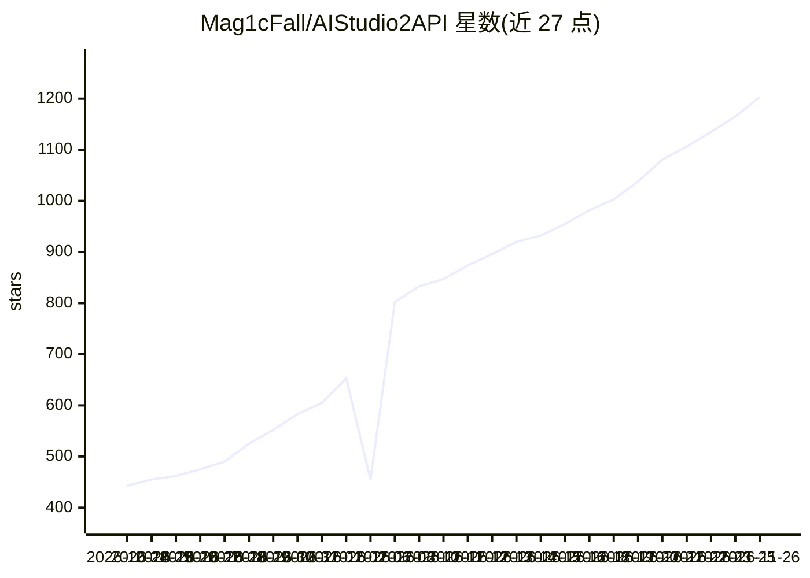

# Mag1cFall/AIStudio2API

⭐ 1,203 · Go · MIT · 推送 2026-11-25 · [GitHub](https://github.com/Mag1cFall/AIStudio2API) · 个人维护 · 中文 README

**把 Google AI Studio 网页反代成 OpenAI/Anthropic/Gemini 兼容 API 的代理服务**

基于 Go 的代理服务，将 Google AI Studio（Playground 与 Build 通道）的网页协议转换为 OpenAI Chat Completions、OpenAI Responses、Anthropic Messages 与 Gemini 四套兼容接口，供 Claude Code、Codex 等客户端接入。支持多账户并发与权益识别、SpiderMonkey/Camoufox 两种 WAA 后端、网页管理界面（账户、用量、日志、配置）、桌面版与在线更新。提供 Releases 安装包、Docker 镜像与源码构建三种途径；Build 旧通道上游默认停用，需通过环境变量启用。

## 筛选速览

| 维度 | 判定 | 备注 |
|---|---|---|
| AI 角色 | `ai-ecosystem` | LLM/agent 周边工具 |
| 许可风险 | `permissive` | MIT |
| 部署形态 | `desktop` | 安装包/桌面程序 |
| 模型依赖 | — | README 未给出锁定关系 |
| 硬件要求 | — | 无带数字的原话,不猜 |
| 安装摩擦 | `low` | 无编译、无系统依赖或容器化 |
| 成熟度 | — | 结构信号不足 |

## 能力要点

- 四套 API 协议：OpenAI Chat/Responses、Anthropic Messages、Gemini GenerateContent
- 多账户高并发，按实时模型目录轮询，识别 Free/Pro/Ultra/Plus 权益
- SpiderMonkey 与 Camoufox 双 WAA 后端，默认不启动浏览器
- 网页管理界面与 Windows/macOS/Linux 桌面版，支持在线更新

## 适用场景

- 把 AI Studio 账户接入 Claude Code、Codex 等 Agent 客户端
- 给 Cherry Studio 等前端配置本地 OpenAI 兼容 Base URL
- 用 Nano Banana、TTS、视频生成等接口做文生图与语音应用

## 场景标签

`模型网关` · 领域:Agent 开发

## 证据(README 行号)

> L7:  一个基于 Go 的高性能代理服务
> L8:  将 Google AI Studio 网页协议转换为 OpenAI、Responses、Anthropic 和 Gemini 兼容 API
> L51: - **四套 API 协议**: OpenAI Chat Completions、OpenAI Responses、Anthropic Messages 与 Gemini GenerateContent；Responses 支持 

## 星数曲线

2026-10-24 443 → 2026-11-26 1,203（+760）

---
*卡片 v1 · prompt 1.4 · 生成 2026-11-24 · 置信度 high · 依据 README sha `13ee374ea7c8` · [字段定义](../../DATASET.md)*
