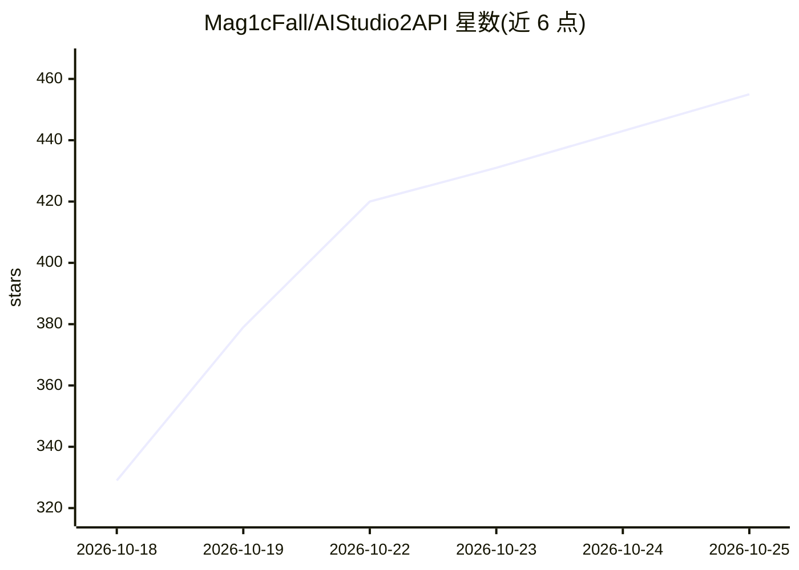

# Mag1cFall/AIStudio2API

⭐ 462 · Go · MIT · 推送 2026-10-25 · [GitHub](https://github.com/Mag1cFall/AIStudio2API) · 个人维护 · 中文 README

**将 Google AI Studio 网页反代为 OpenAI/Anthropic/Gemini 兼容 API 的代理服务**

基于 Go 的代理服务，把 Google AI Studio Playground 与 Build 的网页协议转换为 OpenAI Chat、OpenAI Responses、Anthropic Messages 与 Gemini 四套兼容 API。提供多账户管理、Playground/Build 双额度通道、多账户轮询、用量与日志统计的网页管理端。WAA 后端默认用 Camoufox 浏览器，可切换纯 Go 生成 proof。支持文本、图片（Nano Banana）、视频（Veo）、TTS、转录、Deep Research 与 WebSocket Live。提供 Windows/macOS/Linux 桌面版、命令行版与 Docker 部署；需登录 Google 账户，依赖非官方网页协议。

## 筛选速览

| 维度 | 判定 | 备注 |
|---|---|---|
| AI 角色 | `ai-ecosystem` | LLM/agent 周边工具 |
| 许可风险 | `permissive` | MIT |
| 部署形态 | `desktop` | 安装包/桌面程序 |
| 模型依赖 | locked-api |  |
| 硬件要求 | — | 无带数字的原话,不猜 |
| 安装摩擦 | `low` | 无编译、无系统依赖或容器化 |
| 成熟度 | — | 结构信号不足 |

## 能力要点

- 四套 API 协议：OpenAI Chat/Responses、Anthropic Messages、Gemini GenerateContent
- 多账户管理与 Playground+Build 双额度通道、按权益轮询
- 支持 Claude Code、Codex、OpenCode 等 agent 客户端的工具调用与联网搜索
- 文本/图片/视频/TTS/转录/Deep Research/Live 多模态端点

## 适用场景

- 把 AI Studio 账户额度接入 OpenAI/Anthropic 协议的现有客户端
- 多账户聚合提高并发与额度上限
- 在 Cherry Studio、Claude Code、Codex 等工具中使用 Gemini 模型

## 场景标签

`模型网关` · 领域:Agent 开发

## 证据(README 行号)

> L7:  一个基于 Go 的高性能代理服务
> L8:  将 Google AI Studio 网页协议转换为 OpenAI、Responses、Anthropic 和 Gemini 兼容 API
> L35: - **四套 API 协议**: OpenAI Chat Completions、OpenAI Responses、Anthropic Messages 与 Gemini GenerateContent；Responses 支持 

## 星数曲线

2026-10-18 329 → 2026-10-25 455（+126）

---
*卡片 v1 · prompt 1.4 · 生成 2026-10-21 · 置信度 high · 依据 README sha `92662a4fff70` · [字段定义](../../DATASET.md)*
