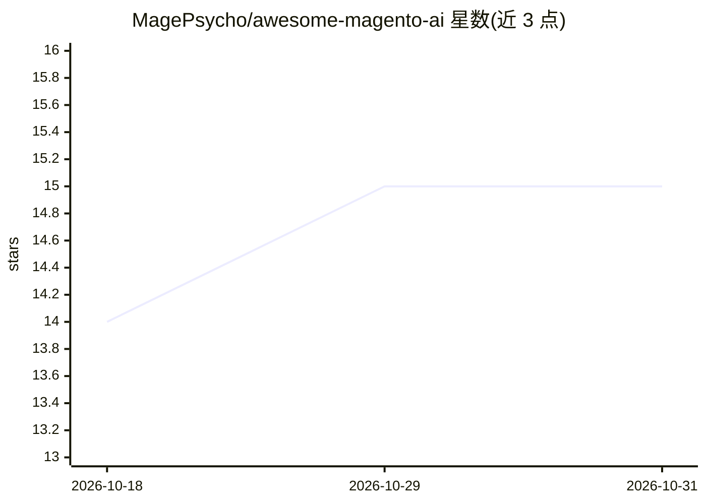

# MagePsycho/awesome-magento-ai

⭐ 15 · CC0-1.0 · 推送 2026-09-02 · [GitHub](https://github.com/MagePsycho/awesome-magento-ai) · [官网](https://github.com/MagePsycho/awesome-magento-ai) · 个人维护

**Magento 生态 AI 工具策展清单：技能、MCP、模块、CLI 等**

面向 Magento 2 / Adobe Commerce / Mage-OS 用户与开发者的策展清单，按工具形态分组：agent 技能与子代理、开发侧与店铺侧 MCP 服务器、商店内 AI 模块（内容生成、管理后台、预测与安全）、SEO/AEO 可发现性、CLI 工具、启动套件与托管商用产品。条目描述取自各项目自身仓库，星标为实时徽章，许可证 CC0-1.0。收录条目本身而非发布软件。

## 筛选速览

| 维度 | 判定 | 备注 |
|---|---|---|
| AI 角色 | `ai-knowledge` | 知识聚合/清单类 |
| 许可风险 | `viral` | CC0-1.0 |
| 部署形态 | `None` |  |
| 模型依赖 | — | README 未给出锁定关系 |
| 硬件要求 | — | 无带数字的原话,不猜 |
| 安装摩擦 | `low` | 无编译、无系统依赖或容器化 |
| 成熟度 | — | 结构信号不足 |

## 能力要点

- 按工具形态（技能/MCP/模块/CLI/启动套件/托管）分组组织条目
- 覆盖开发侧与店铺侧 MCP 服务器两类接入层
- 条目描述取自各项目自身仓库，星标为实时徽章
- 含 SEO/AEO/LLM 可发现性专区（llms.txt、AI 爬虫规则等）

## 适用场景

- 为 Magento 项目挑选 agent 技能包或 MCP 服务器
- 查找商店内 AI 功能模块（内容生成、预测、防欺诈）
- 了解 Magento 生态 AI 工具的整体覆盖情况

## 场景标签

`精选清单` · 领域:学习与行业

## 证据(README 行号)

> L3: **A curated list of AI tooling for Magento 2, Adobe Commerce and Mage-OS** — agent skills, MCP servers, store module
> L9: Entries are grouped by **what kind of thing a tool is**, not by who made it — so you can jump straight to the layer 
> L11: Every description here comes from the project's own repository or site. Star counts are live badges, never stale.

## 星数曲线

2026-10-18 14 → 2026-10-31 15（+1）

---
*卡片 v1 · prompt 1.4 · 生成 2026-10-30 · 置信度 high · 依据 README sha `cbb27f54c354` · [字段定义](../../DATASET.md)*
