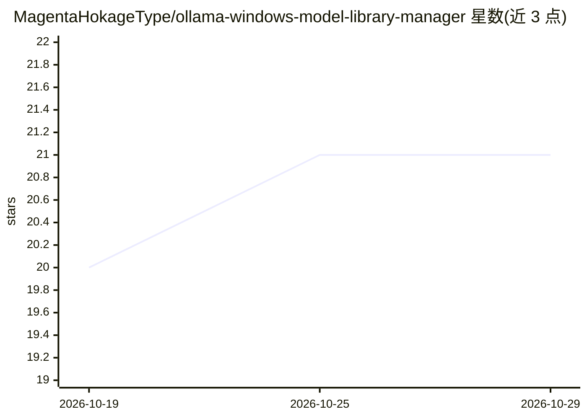

# MagentaHokageType/ollama-windows-model-library-manager

⭐ 21 · CSS · MIT · 推送 2026-10-19 · [GitHub](https://github.com/MagentaHokageType/ollama-windows-model-library-manager) · 个人维护

**Windows 下的 Ollama 模型库管理与本地模型下载工具**

面向 Windows 用户的独立工具，围绕 Ollama 模型管理、模型库整理与本地模型下载组织工作流：检测模型/运行时/GPU/存储上下文，分析配置，保存或应用档案（profile），并支持备份与回滚恢复。以 GitHub Release 的 ZIP 压缩包分发，解压后运行 OllamaWindowsModelLibraryManager.exe。README 自述为独立仓库，非 Ollama/NVIDIA/Microsoft 官方工具；不含商业 AI 模型，许可取决于所选模型提供方与运行时。

## 筛选速览

| 维度 | 判定 | 备注 |
|---|---|---|
| AI 角色 | `ai-ecosystem` | LLM/agent 周边工具 |
| 许可风险 | `permissive` | MIT |
| 部署形态 | `desktop` | 安装包/桌面程序 |
| 模型依赖 | local-ok | 支持本地模型 |
| 硬件要求 | — | 无带数字的原话,不猜 |
| 安装摩擦 | `low` | 无编译、无系统依赖或容器化 |
| 成熟度 | — | 结构信号不足 |

## 能力要点

- 围绕 Ollama 模型管理与模型库下载组织工作流
- 备份优先的配置变更与可复用的配置档案
- 恢复工作流支持回滚到已知良好配置

## 适用场景

- 在 Windows 上整理 Ollama 模型库与本地模型下载
- 变更本地 AI 配置前做备份并支持回滚
- 排查本地 AI 运行时的配置问题

## 场景标签

 · 领域:本地 AI/模型管理工具

## 证据(README 行号)

> L5: > **A focused Windows utility for ollama model manager, model library, and practical local-AI setup or recovery work
> L19: **Ollama Windows Model Library Manager** is designed to organize a Windows workflow around **ollama model manager**

## 星数曲线

2026-10-19 20 → 2026-10-29 21（+1）

---
*卡片 v1 · prompt 1.4 · 生成 2026-10-28 · 置信度 mid · 依据 README sha `83ae3a70c479` · [字段定义](../../DATASET.md)*
