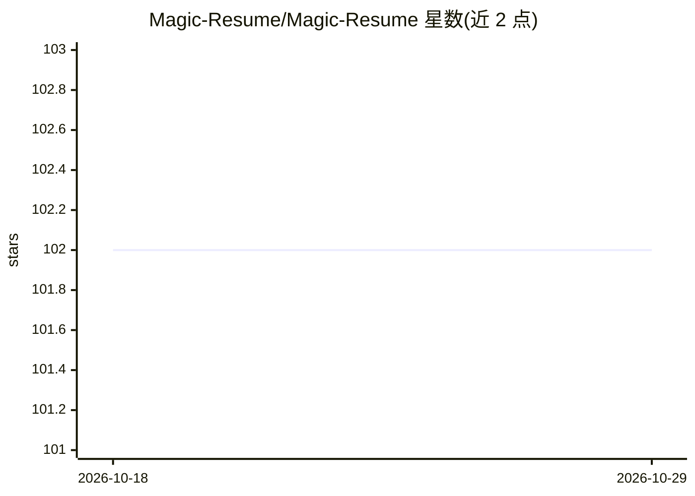

# Magic-Resume/Magic-Resume

⭐ 102 · TypeScript · MIT · 推送 2026-10-25 · [GitHub](https://github.com/Magic-Resume/Magic-Resume) · [官网](https://www.magic-resume.cn) · 组织维护 · 中文 README

**开源 AI 简历工作台：AI 逐条提出修改，用户逐条采纳**

基于 Next.js 15 + TypeScript 的浏览器端简历编辑器：实时预览、20 套 ATS 友好模板、版本快照与分享。AI 功能包括 JD 匹配优化、简历健康评分、一键翻译与模拟面试，支持自带 OpenAI/Gemini/Claude/DeepSeek 等 API key。自托管模式纯浏览器运行、数据存 IndexedDB、无需后端；另内置 MCP 服务器，让 Claude Code/Cursor/Windsurf 等编程工具通过 JSON Patch 读写简历。云版本提供多端同步与付费方案。

## 筛选速览

| 维度 | 判定 | 备注 |
|---|---|---|
| AI 角色 | `ai-native` | 本体是模型或模型工具 |
| 许可风险 | `permissive` | MIT |
| 部署形态 | `library` | 以包/库形式分发 |
| 模型依赖 | locked-api |  |
| 硬件要求 | — | 无带数字的原话,不猜 |
| 安装摩擦 | `low` | 无编译、无系统依赖或容器化 |
| 成熟度 | — | 结构信号不足 |

## 能力要点

- AI 就地提出修改、用户逐条 accept/skip 的编辑流
- 20 套 ATS 友好模板，颜色/字体/版式可调
- 原生 MCP 服务器，AI 编程工具可基于 schema 做补丁式编辑
- 自托管模式纯浏览器运行，数据仅存 IndexedDB

## 适用场景

- 编辑并优化针对特定 JD 的简历
- 获取简历健康评分与可执行的修改建议
- 让 Claude Code/Cursor 等工具直接读写我的简历
- 多语言简历翻译与 AI 模拟面试练习

## 场景标签

`AI 写作` · 领域:内容生成

## 证据(README 行号)

> L7:  The open-source AI resume workbench. The AI proposes edits in place; you accept or skip each one.
> L26: **Magic Resume is an open-source AI resume workbench: the AI proposes edits in place and you accept or skip each on
> L68: - **JD matching** — AI reads a job description and rewrites content to fit.

## 星数曲线

2026-10-18 102 → 2026-10-29 102（+0）

---
*卡片 v1 · prompt 1.4 · 生成 2026-10-23 · 置信度 high · 依据 README sha `e946d262d669` · [字段定义](../../DATASET.md)*
