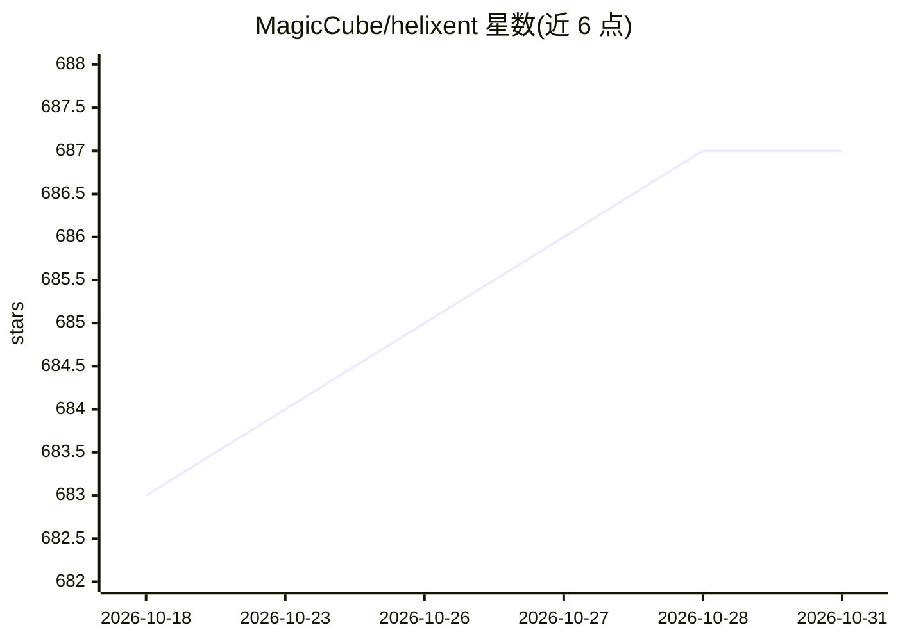

# MagicCube/helixent

⭐ 687 · TypeScript · 推送 2026-05-21 · [GitHub](https://github.com/MagicCube/helixent) · 个人维护 · 中文 README

**基于 Bun 的 ReAct 式 agent 循环库与编码 agent CLI**

TypeScript 库，提供可复用的 ReAct 风格 agent 循环、Model/Message/Tool 核心抽象和中间件系统，并在其上构建面向编码场景的 agent 层（bash、read_file、str_replace、apply_patch 等工具）与交互式 TUI CLI。支持标准 agent 技能格式从多个目录发现加载、AGENTS.md 项目指引、工具调用审批的人机协同。面向开发者，可通过 npm 全局安装或 npx 直接运行，也作为库导入并用 OpenAI 兼容 provider 构建 agent。运行时栈为 Bun，可编译为单一可执行文件。

## 筛选速览

| 维度 | 判定 | 备注 |
|---|---|---|
| AI 角色 | `ai-ecosystem` | LLM/agent 周边工具 |
| 许可风险 | `none` | — |
| 部署形态 | `library` | 以包/库形式分发 |
| 模型依赖 | — | README 未给出锁定关系 |
| 硬件要求 | — | 无带数字的原话,不猜 |
| 安装摩擦 | `low` | 无编译、无系统依赖或容器化 |
| 成熟度 | — | 结构信号不足 |

## 能力要点

- 中间件系统覆盖 agent 循环各阶段（8 个 hook）
- 标准 agent 技能格式，从 4 类目录发现加载
- 编码 agent 预置 bash/文件读写/补丁等工具与计划模式
- 工具调用的人机协同审批支持

## 适用场景

- 直接用 CLI 在项目中运行交互式编码 agent
- 以库形式构建自定义 ReAct agent 与 provider 接入
- 通过中间件扩展 agent 的状态管理与工具编排

## 场景标签

`Agent 框架` `编码 Agent` · 领域:Agent 开发

## 证据(README 行号)

> L30:  - A reusable ReAct-style agent loop.
> L177: - **Model** — A unified abstraction over LLM providers. Define a model once, swap providers without changing agent
> L194: A domain-specific agent built on top of the generic agent loop, pre-configured with coding-oriented tools (`read_f

## 星数曲线

2026-10-18 683 → 2026-10-31 687（+4）

---
*卡片 v1 · prompt 1.4 · 生成 2026-10-18 · 置信度 high · 依据 README sha `699b92e9100a` · [字段定义](../../DATASET.md)*
