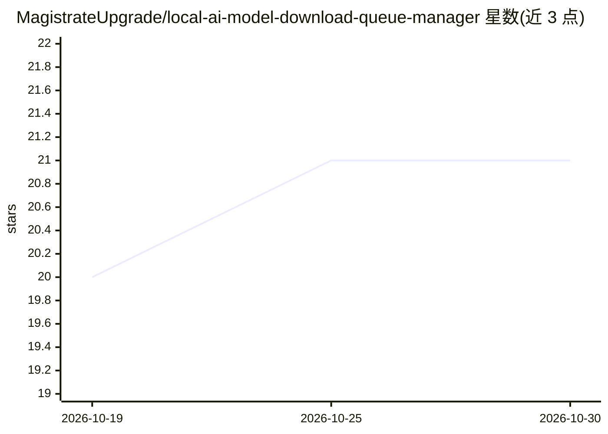

# MagistrateUpgrade/local-ai-model-download-queue-manager

⭐ 21 · CSS · MIT · 推送 2026-10-19 · [GitHub](https://github.com/MagistrateUpgrade/local-ai-model-download-queue-manager) · 个人维护

**Windows 本地 AI 模型下载队列管理工具，支持断点续传**

面向 Windows 的独立下载管理工具：围绕本地 AI 模型下载组织工作流，功能包括下载任务管理、断点续传检查、本地模型队列、可复用配置档案与备份优先的恢复流程。以 GitHub Release 的 ZIP 压缩包形式分发，解压后运行 exe，无需编译。声明为独立工具，不隶属于 Ollama、NVIDIA、AMD、微软或模型提供商，仓库本身不包含商业模型；提示需自行核验运行时与模型的行为。

## 筛选速览

| 维度 | 判定 | 备注 |
|---|---|---|
| AI 角色 | `ai-ecosystem` | LLM/agent 周边工具 |
| 许可风险 | `permissive` | MIT |
| 部署形态 | `desktop` | 安装包/桌面程序 |
| 模型依赖 | — | README 未给出锁定关系 |
| 硬件要求 | — | 无带数字的原话,不猜 |
| 安装摩擦 | `low` | 无编译、无系统依赖或容器化 |
| 成熟度 | — | 结构信号不足 |

## 能力要点

- 模型下载管理与断点续传检查
- 本地模型队列与可复用配置档案
- 备份优先的更改与恢复工作流
- ZIP 压缩包分发，解压即运行 exe

## 适用场景

- 在 Windows 上组织多个本地 AI 模型的下载队列
- 下载中断后从断点续传模型文件
- 为本地 AI 运行时保存和恢复已知可用的配置

## 场景标签

 · 领域:本地 AI 工具/下载管理

## 证据(README 行号)

> L19: **Local AI Model Download Queue Manager** is designed to organize a Windows workflow around **model download manage
> L43: 1. **Select / Detect** — choose the relevant model, runtime, GPU, API, or storage context.

## 星数曲线

2026-10-19 20 → 2026-10-30 21（+1）

---
*卡片 v1 · prompt 1.4 · 生成 2026-10-28 · 置信度 mid · 依据 README sha `c4813798d34a` · [字段定义](../../DATASET.md)*
