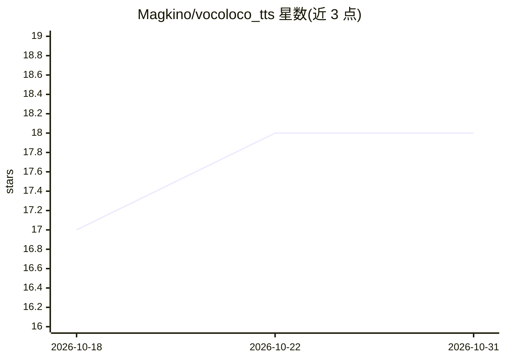

# Magkino/vocoloco_tts

⭐ 18 · JavaScript · Apache-2.0 · 推送 2026-10-17 · [GitHub](https://github.com/Magkino/vocoloco_tts) · [官网](https://magkino.github.io/vocoloco_tts/) · 个人维护

**浏览器内本地运行的文本转语音与声音克隆 Web 应用**

本地优先的开源 TTS Web 应用：在浏览器中以自研 WebGPU 引擎运行 600M 参数的 OmniVoice 扩散 TTS 模型，支持 600+ 种语言、性别/音高控制、长文本（2000 字符）分句合成与 MP3 导出。声音克隆通过录制或上传 3-30 秒音频完成，由设备端 Whisper large-v3-turbo 自动转写，全程无服务器、无 API key、无上传，模型缓存后可离线使用。无 WebGPU 的浏览器回退到 ONNX Runtime（较慢）。首次下载约 1.2 GB（含声音克隆约 2.7 GB）。

## 筛选速览

| 维度 | 判定 | 备注 |
|---|---|---|
| AI 角色 | `ai-native` | 本体是模型或模型工具 |
| 许可风险 | `permissive` | Apache-2.0 |
| 部署形态 | `self-host` | docker 或自建部署 |
| 模型依赖 | — | README 未给出锁定关系 |
| 硬件要求 | — | 无带数字的原话,不猜 |
| 安装摩擦 | `low` | 无编译、无系统依赖或容器化 |
| 成熟度 | — | 结构信号不足 |

## 能力要点

- 自研 WebGPU 引擎（手写 WGSL 内核）在浏览器内运行扩散 TTS 模型
- 600+ 语言、0.85×–1.1× 变速、[pause] 标记控制停顿
- 设备端声音克隆：3-30 秒参考音频 + Whisper 自动转写
- 无 WebGPU 环境回退 ONNX Runtime Web（WebAssembly/WebGPU）

## 适用场景

- 不依赖云服务、不上传文本地在本地生成语音
- 用自己的录音克隆声音并导出 MP3
- 在手机浏览器离线做多语言文本转语音

## 场景标签

`语音合成` · 领域:内容生成

## 证据(README 行号)

> L9: VocoLoco is an open-source, local-first text-to-speech web app. It runs OmniVoice, a 600M-parameter diffusion TTS mo
> L24: - **Automatic transcription**: Whisper large-v3-turbo transcribes the selected part on your device (~100 languages,
> L62: 5. **MP3 export**: client-side encoding with ID3v2 metadata marking audio as AI-generated

## 星数曲线

2026-10-18 17 → 2026-10-31 18（+1）

---
*卡片 v1 · prompt 1.4 · 生成 2026-10-29 · 置信度 high · 依据 README sha `f382a30bc411` · [字段定义](../../DATASET.md)*
