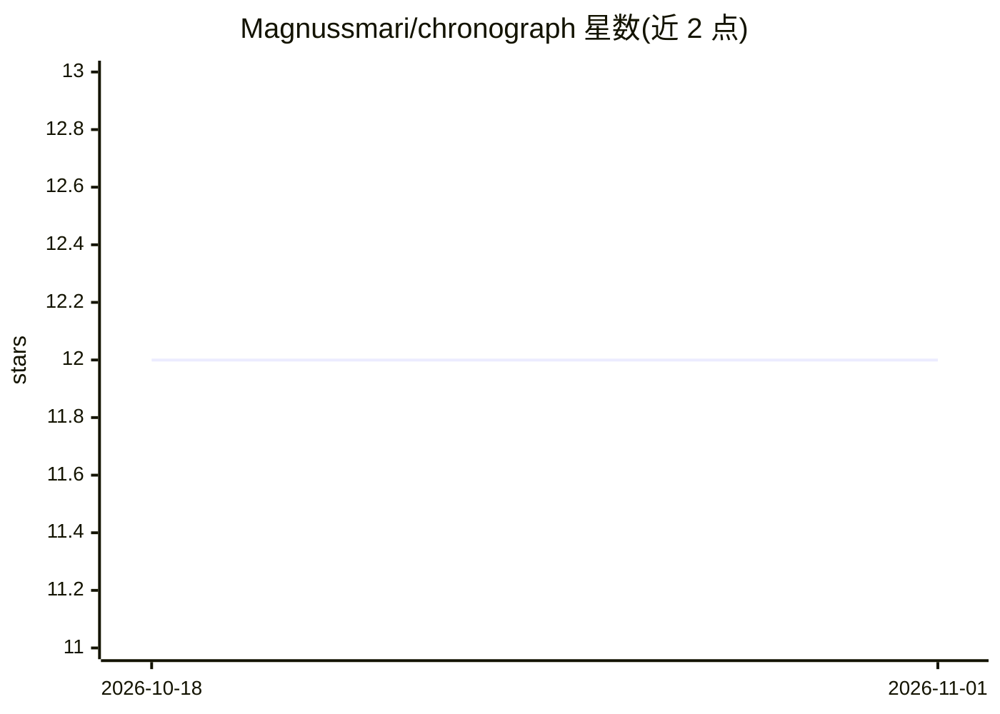

# Magnussmari/chronograph

⭐ 12 · TypeScript · MIT · 推送 2026-08-06 · [GitHub](https://github.com/Magnussmari/chronograph) · [官网](https://timeline.sumarhus.com) · 个人维护

**AI 生成的 5,226 年人类历史逐年 JSON 语料库与阅读前端**

由 AI（Claude Sonnet 4.6，57.7 小时批处理完成）研究生成的结构化历史语料：每年一个 JSON，共 17,991 个事件、13,130 条跨年图边，99.85% 事件标注来源并声明地理盲区。含第二层学术证据（Scite MCP 检索文献、与 Grok 生成的论断分离）与 EN→IS 翻译管线（Gemini Flash 3）。前端为 Next.js 16 三视图站点（Notebook/Stratum/Atlas）。项目当前状态为 parked（主开发暂停），冰岛语回译仅 19/5,226 年，供研究者与后续贡献者接手。

## 筛选速览

| 维度 | 判定 | 备注 |
|---|---|---|
| AI 角色 | `ai-knowledge` | 知识聚合/清单类 |
| 许可风险 | `permissive` | MIT |
| 部署形态 | `library` | 以包/库形式分发 |
| 模型依赖 | — | README 未给出锁定关系 |
| 硬件要求 | — | 无带数字的原话,不猜 |
| 安装摩擦 | `low` | 无编译、无系统依赖或容器化 |
| 成熟度 | — | 结构信号不足 |

## 能力要点

- 5,226 年逐年 JSON 语料，99.85% 事件带来源标注与确定性分级
- 43 个可重叠时代（chronological/thematic/crisis/regional 四类）
- 论断生成（Grok）与证据检索（Scite MCP）分离的研究流程
- Next.js 16 三视图前端：Notebook 阅读、Stratum 仪表、Atlas 正射地球（17,515 事件点）

## 适用场景

- 按年浏览与检索有来源标注的人类历史事件
- 以结构化数据形式获取历史事件与因果图边
- 为 LLM 或知识图谱项目提供带出处的历史语料

## 场景标签

 · 领域:人文历史/知识数据集

## 证据(README 行号)

> L3: > 5,226 years. One JSON per year. 99.85% of events name a source; every year declares which regions its sources do n
> L31: |**Layer 1 — Corpus**|5,226 ICCRA-schema JSON files, one per year, 2025 CE → 3,200 BCE|✅ 2026-04-13|
> L52: Every year is a structured JSON with events, primary sources, certainty levels, geographic-gap declarations, and ca

## 星数曲线

2026-10-18 12 → 2026-11-01 12（+0）

---
*卡片 v1 · prompt 1.4 · 生成 2026-11-01 · 置信度 mid · 依据 README sha `1a93666fda73` · [字段定义](../../DATASET.md)*
