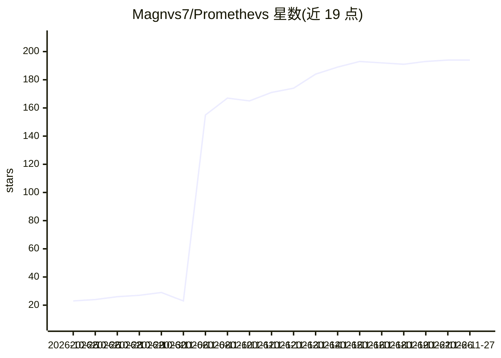

# Magnvs7/Promethevs

⭐ 194 · CC-BY-4.0 · 推送 2026-11-09 · [GitHub](https://github.com/Magnvs7/Promethevs) · 个人维护

**在消费级 PC 上运行完整 510GB DeepSeek 模型的推理引擎**

PROMETHEVS 引擎采用 compress-then-correct 方法：先用 2-bit 压缩的专家副本计算每个词，当模型置信度低时用存储的校正平面还原原始 FP4 权重重算，从而在 64 GB 内存加一块 12 GB NVIDIA 显卡的 Windows PC 上运行 DeepSeek-V4.1-Flash-1017 全量权重。提供 OpenAI 兼容本地端点（含流式与工具调用），安装包内置硬件检查、权重下载与存储构建脚本；引擎为 Apache-2.0，报告与日志为 CC BY 4.0。仅支持 Windows 与指定 NVIDIA 卡，一次服务一个请求。

## 筛选速览

| 维度 | 判定 | 备注 |
|---|---|---|
| AI 角色 | `ai-ecosystem` | LLM/agent 周边工具 |
| 许可风险 | `viral` | CC-BY-4.0 |
| 部署形态 | `desktop` | 安装包/桌面程序 |
| 模型依赖 | locked-api |  |
| 硬件要求 | — | 无带数字的原话,不猜 |
| 安装摩擦 | `low` | 无编译、无系统依赖或容器化 |
| 成熟度 | — | 结构信号不足 |

## 能力要点

- compress-then-correct：2-bit 专家草稿+按置信度触发原始权重校正
- OpenAI 兼容本地端点（localhost:8100/v1），支持流式与工具调用
- 安装脚本含硬件检查、权重下载（校验哈希）、存储构建与速度验证
- 附技术报告、全部运行的日志与复现步骤

## 适用场景

- 在一台游戏 PC 上本地运行完整 DeepSeek-V4.1-Flash
- 为支持 OpenAI API 的应用和编码 agent 提供本地推理端点
- 数据不出本机的私有聊天/推理部署

## 场景标签

`推理引擎` `模型量化` · 领域:训练与推理

## 证据(README 行号)

> L14: The **PROMETHEVS engine** gets there with **compress-then-correct**, a method devised by Ryan Flavell. Every word i
> L19: - **Works with your tools.** An OpenAI-compatible endpoint on `localhost`, with streaming and tool calls, so apps a

## 星数曲线

2026-10-25 23 → 2026-11-27 194（+171）

---
*卡片 v1 · prompt 1.4 · 生成 2026-11-25 · 置信度 high · 依据 README sha `564a24a668f5` · [字段定义](../../DATASET.md)*
