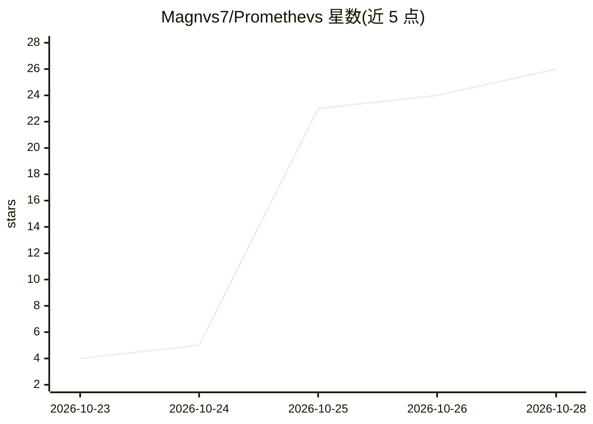

# Magnvs7/Promethevs

⭐ 26 · CC-BY-4.0 · 推送 2026-10-23 · [GitHub](https://github.com/Magnvs7/Promethevs) · 组织维护

**在 64GB 内存消费级 PC 上运行完整 510GB DeepSeek 模型的推理引擎**

PROMETHEVS 是一套本地推理引擎加 OpenAI 兼容服务端，通过 compress-then-correct 方法在普通游戏 PC（64GB 内存 + 12GB NVIDIA 显卡）上运行完整 510GB 的 DeepSeek-V4.1-Flash-1017 原始权重：每个词先由 2-bit 压缩专家计算，模型置信度低时用校正平面重建原始权重重算，报告与精确解码 98.3% 一致，代码提示最高 7.4 tokens/s。面向想在 Windows 本机自托管该模型的开发者，限制包括：仅支持单卡 RTX 30/40 系列、单请求、约 1.1TB NVMe 磁盘需求、构建耗时约 4 小时、未在第二台机器复现。

## 筛选速览

| 维度 | 判定 | 备注 |
|---|---|---|
| AI 角色 | `ai-ecosystem` | LLM/agent 周边工具 |
| 许可风险 | `viral` | CC-BY-4.0 |
| 部署形态 | `desktop` | 安装包/桌面程序 |
| 模型依赖 | locked-api |  |
| 硬件要求 | — | 无带数字的原话,不猜 |
| 安装摩擦 | `low` | 无编译、无系统依赖或容器化 |
| 成熟度 | `idea` | |

## 能力要点

- compress-then-correct：2-bit 专家草算 + 置信度门控的精确校正
- 完整 510GB 原始权重本地运行，权重哈希校验、本机构建存储
- OpenAI 兼容本地端点，支持流式与工具调用
- 提供硬件检查、构建、启动与验证脚本及技术报告与完整日志

## 适用场景

- 在自家游戏 PC 上离线运行完整 DeepSeek 模型，数据不出本机
- 让使用 OpenAI API 的应用和编码 agent 指向本地端点
- 复现论文级测量：报告、RESULTS.md 与未编辑日志全部公开

## 场景标签

`推理引擎` · 领域:训练与推理

## 证据(README 行号)

> L18: - **Works with your tools.** An OpenAI-compatible endpoint on `localhost`, with streaming and tool calls, so apps a
> L51: 3. Point any OpenAI-compatible app at `http://127.0.0.1:8100/v1`, model `deepseek-v4.1-flash-1017-promethevs`, any 

## 星数曲线

2026-10-23 4 → 2026-10-28 26（+22）

---
*卡片 v1 · prompt 1.4 · 生成 2026-10-27 · 置信度 high · 依据 README sha `82f23b781db9` · [字段定义](../../DATASET.md)*
