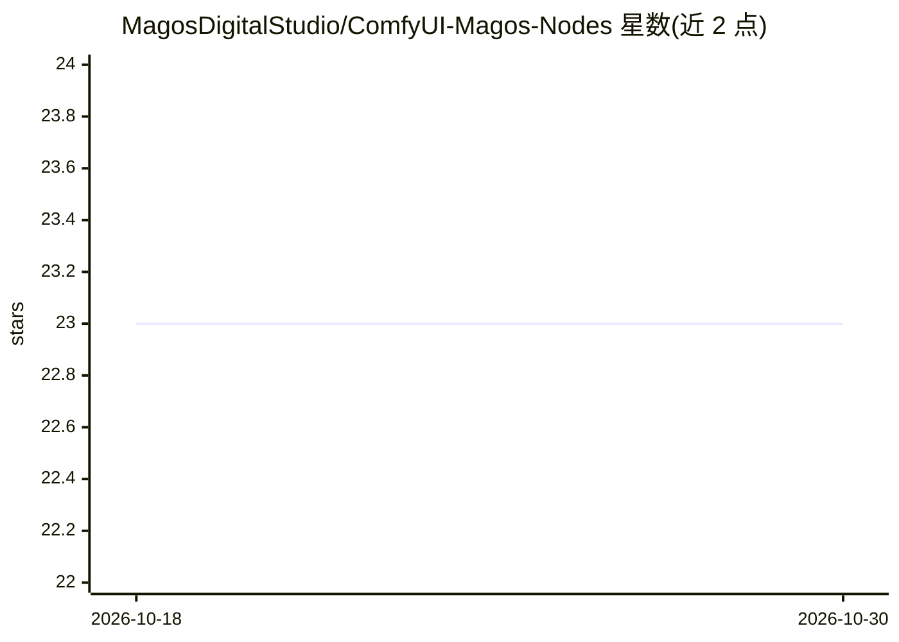

# MagosDigitalStudio/ComfyUI-Magos-Nodes

⭐ 23 · JavaScript · GPL-3.0 · 推送 2026-05-15 · [GitHub](https://github.com/MagosDigitalStudio/ComfyUI-Magos-Nodes) · [官网](http://www.magosdigitalstudio.com) · 组织维护

**ComfyUI 姿态节点包：DWPose/NLF 骨架提取、编辑与重定向**

Magos Digital Studio 开发的 ComfyUI 自定义节点包，面向需要精细姿态控制的 ComfyUI 用户：从视频批次提取 DWPose 身体/手部/面部关键点及 NLF 3D SMPL 关节，在全屏交互编辑器中逐帧编辑（时间轴、曲线、Dope Sheet、3D 视口、动画相机），对 DWPose 骨架做簇级缩放/偏移/旋转重定向，并输出姿态图像。输出标准 ComfyUI 类型，可接入 WanAnimate、ControlNet、SCAIL、LTX-Video、UniAnimate 等管线。限制：重定向仅作用于 DWPose，NLF 数据不参与簇变换；NLF 3D 需额外安装 ComfyUI-SCAIL-Pose 并下载模型文件。

## 筛选速览

| 维度 | 判定 | 备注 |
|---|---|---|
| AI 角色 | `ai-ecosystem` | LLM/agent 周边工具 |
| 许可风险 | `viral` | GPL-3.0 |
| 部署形态 | `None` |  |
| 模型依赖 | — | README 未给出锁定关系 |
| 硬件要求 | — | 无带数字的原话,不猜 |
| 安装摩擦 | `low` | 无编译、无系统依赖或容器化 |
| 成熟度 | — | 结构信号不足 |

## 能力要点

- 从视频批次提取 DWPose 关键点与 NLF 3D SMPL 关节
- 全屏交互编辑器：时间轴/曲线/Dope Sheet/多视口/3D Orbit/动画相机
- DWPose 簇级重定向（缩放/偏移/旋转，带 Ref Frame 相机无关参考）
- 输出标准 IMAGE/POSE_KEYPOINT 类型，接入 ControlNet、WanAnimate、SCAIL、LTX-Video、UniAnimate

## 适用场景

- 视频转姿态驱动图生视频/图生动画（WanAnimate、LTX 等）
- 逐帧修正姿态检测结果并生成 ControlNet 条件图
- 调整角色身体比例后用于姿态迁移管线

## 场景标签

`目标检测` `图像视频处理` · 领域:感知与多模态

## 证据(README 行号)

> L5: A professional node pack by **Magos Digital Studio** for precise pose control inside ComfyUI.
> L8: The pack is engine-agnostic: it outputs standard ComfyUI types (`IMAGE`, `POSE_KEYPOINT`, `BBOX`) and the WanAnimate
> L16: |**Magos DWP Extractor**|Temporal Editor|Detect body, hand, and face keypoints from a video batch; optional NLF 3D 

## 星数曲线

2026-10-18 23 → 2026-10-30 23（+0）

---
*卡片 v1 · prompt 1.4 · 生成 2026-10-27 · 置信度 high · 依据 README sha `2fb9b9d97fdd` · [字段定义](../../DATASET.md)*
