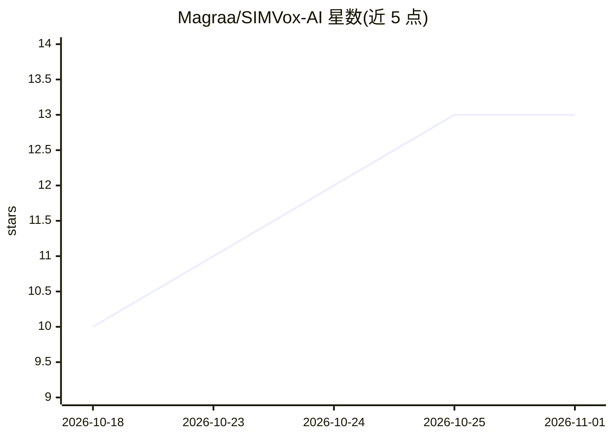

# Magraa/SIMVox-AI

⭐ 13 · Python · MIT · 推送 2026-08-26 · [GitHub](https://github.com/Magraa/SIMVox-AI) · 个人维护

**把 Android SIM 卡手机变成 AI 电话客服的桌面系统**

通过 ADB 与音频桥接把 PC 连接到实体 Android 手机，利用 SIM 卡直接接听和拨打蜂窝电话，通话由 Google Gemini LLM 生成对话、Microsoft Edge Neural TTS 合成语音，支持来电自动接听、自主外呼拨号。提供 pywebview 桌面仪表盘：实时音频可视化、通话转写、SQLite 通话记录与 CRM 导出。音频链路支持蓝牙 HFP、3.5mm TRRS 分线器或虚拟声卡；通过 SYSTEM_PROMPT 配置客服、诊所预约、餐厅预订等角色。需自备 Android 9.0+ 手机与 Gemini API Key，README 附通话录音与自动电话的法规合规提示。

## 筛选速览

| 维度 | 判定 | 备注 |
|---|---|---|
| AI 角色 | `ai-native` | 本体是模型或模型工具 |
| 许可风险 | `permissive` | MIT |
| 部署形态 | `None` |  |
| 模型依赖 | — | README 未给出锁定关系 |
| 硬件要求 | — | 无带数字的原话,不猜 |
| 安装摩擦 | `low` | 无编译、无系统依赖或容器化 |
| 成熟度 | — | 结构信号不足 |

## 能力要点

- ADB 桥接 PC 与 Android 手机，经 SIM 卡直接接听/拨打蜂窝电话，不经 VoIP 服务
- Gemini LLM 对话推理 + Edge Neural TTS 语音合成，100+ 声音可选
- 来电自动接听、自主外呼拨号与实时转写
- pywebview 桌面面板：音频可视化、一键拨号、SQLite 通话记录与 CRM 导出

## 适用场景

- 用实体 SIM 卡号自动接听客户来电并做 AI 应答
- 让 AI 代理拨打外呼电话完成预约或客服任务
- 通过 SYSTEM_PROMPT 定制接待员、诊所预约、餐厅预订等角色

## 场景标签

`语音 Agent` · 领域:对话与助手

## 证据(README 行号)

> L27: **SIMVox AI bypasses all VoIP aggregators entirely.** It bridges your PC directly to an **Android Smartphone** usin
> L41: |🧠 **Gemini LLM Brain**|Powered by high-speed Google Gemini models for conversational reasoning and intent analysis

## 星数曲线

2026-10-18 10 → 2026-11-01 13（+3）

---
*卡片 v1 · prompt 1.4 · 生成 2026-10-31 · 置信度 high · 依据 README sha `97e4f15f3430` · [字段定义](../../DATASET.md)*
