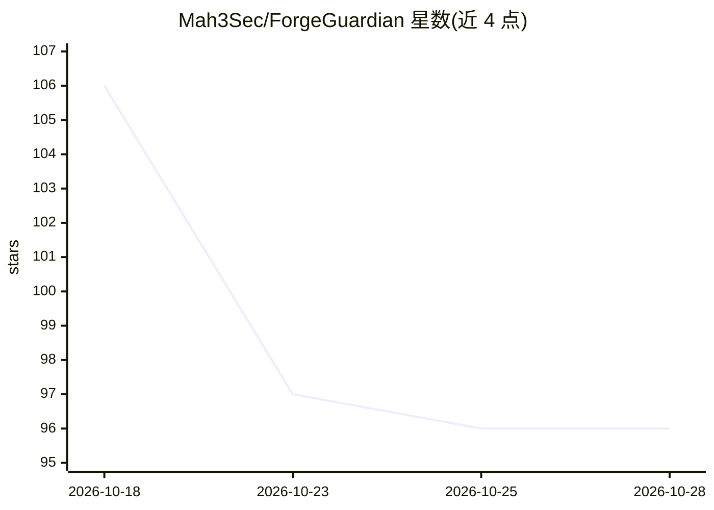

# Mah3Sec/ForgeGuardian

⭐ 96 · Go · Apache-2.0 · 推送 2026-09-19 · [GitHub](https://github.com/Mah3Sec/ForgeGuardian) · [官网](https://forgeguardian.dev/docs/) · 个人维护

**本地优先的软件供应链安全扫描平台，含可选 AI 辅助**

面向开发与安全团队的供应链安全扫描器：8 个引擎（OSV、行为分析、恶意软件模式、AI 模型权重检查、MCP 提示注入检测，及可选 Grype/Trivy/Semgrep）并发扫描，覆盖 npm/PyPI/Go/Maven 等 9 个生态，内置 223+ 检测签名。提供 CLI（fgctl）、Web 仪表盘（30+ 页面：SBOM 生成、策略即代码、Sigstore 签名、依赖拓扑）、Docker 与 CI/CD 集成。AI 部分为可选的咨询与补丁 agent，支持本地 LLM，核心扫描离线运行。社区版 Apache 2.0，另提供含团队功能的 Pro 版。

## 筛选速览

| 维度 | 判定 | 备注 |
|---|---|---|
| AI 角色 | `ai-enhanced` | 去掉 AI 部分产品仍成立 |
| 许可风险 | `permissive` | Apache-2.0 |
| 部署形态 | `self-host` | docker 或自建部署 |
| 模型依赖 | — | README 未给出锁定关系 |
| 硬件要求 | — | 无带数字的原话,不猜 |
| 安装摩擦 | `low` | 无编译、无系统依赖或容器化 |
| 成熟度 | — | 结构信号不足 |

## 能力要点

- 8 个并发扫描引擎，覆盖 9 个包生态
- 223+ 检测签名覆盖 2016-2026 真实供应链攻击
- SBOM（CycloneDX/SPDX）、Sigstore 签名、策略即代码
- 离线优先：扫描本地运行，零遥测，支持 airgap 部署

## 适用场景

- 扫描项目依赖中的已知漏洞与恶意包
- 生成 SBOM 并管理依赖风险等级
- 接入 CI/CD 流水线做供应链安全门禁

## 场景标签

`网络安全` · 领域:学习与行业

## 证据(README 行号)

> L143: - **AI triage** — optional AI advisory and patch agent (supports multiple providers)
> L175: - AI features are opt-in — supports multiple providers including local LLMs

## 星数曲线

2026-10-18 106 → 2026-10-28 96（-10）

---
*卡片 v1 · prompt 1.4 · 生成 2026-10-23 · 置信度 mid · 依据 README sha `d855e9e40b80` · [字段定义](../../DATASET.md)*
