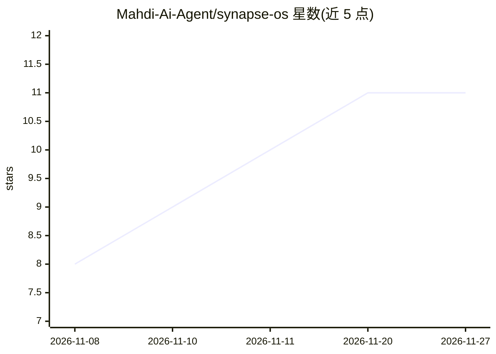

# Mahdi-Ai-Agent/synapse-os

⭐ 11 · TypeScript · MIT · 推送 2026-11-05 · [GitHub](https://github.com/Mahdi-Ai-Agent/synapse-os) · 个人维护

**本地 Markdown 知识库：AI 代你整理、链接并规划笔记**

以本地 Markdown 文件夹（YAML frontmatter + wikilinks）为存储的第二大脑/生活管理应用。用户用一句话（波斯语或英语）录入想法，由 AI 归类、建立链接、设置到期日，并以 WebGL 地图可视化；每天给出待办优先级与周期回顾。AI 不走云服务，而是调用用户已登录的 Claude Code 或 Codex CLI（或 API key），每次运行以 git commit 记录、可一键撤销。桌面应用目前仅限 Apple Silicon Mac，也可用 Docker 自托管或浏览器访问；vault 与 Obsidian 兼容。

## 筛选速览

| 维度 | 判定 | 备注 |
|---|---|---|
| AI 角色 | `ai-native` | 本体是模型或模型工具 |
| 许可风险 | `permissive` | MIT |
| 部署形态 | `desktop` | 安装包/桌面程序 |
| 模型依赖 | — | README 未给出锁定关系 |
| 硬件要求 | — | 无带数字的原话,不猜 |
| 安装摩擦 | `low` | 无编译、无系统依赖或容器化 |
| 成熟度 | — | 结构信号不足 |

## 能力要点

- AI 负责归类、链接与到期日，文件始终是本地 Markdown
- 复用用户已有的 Claude Code/Codex 订阅登录，无需额外 API key
- MCP server + OAuth，可让 Claude/ChatGPT 搜索读写 vault
- 每次 AI 运行即 git commit，可撤销；Mac 端 AES-256 加密

## 适用场景

- 一句话随手记录想法，由 AI 自动归档建链
- 在 Obsidian 中打开同一份 vault 共同使用
- Docker 自托管后手机与多台电脑访问同一知识库

## 场景标签

`知识库管理` · 领域:知识与检索

## 证据(README 行号)

> L24: Synapse is an AI-native second brain and life OS. Your notes, ideas, tasks, projects, goals, habits, people and jou
> L26: The brain is not a service we run. It is **your own AI subscription**: Synapse starts the official, unmodified comm
> L50: 2. **Your brain runs.** Synapse spawns your signed-in `claude` (or `codex`) with the vault as its folder, the right

## 星数曲线

2026-11-08 8 → 2026-11-27 11（+3）

---
*卡片 v1 · prompt 1.4 · 生成 2026-11-20 · 置信度 high · 依据 README sha `f98bc6ee8a3d` · [字段定义](../../DATASET.md)*
