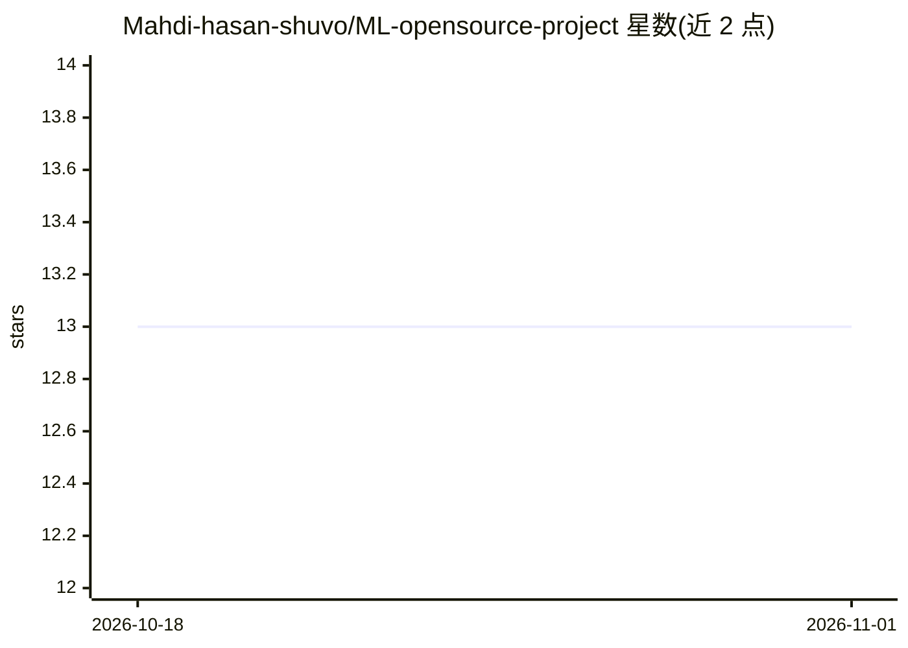

# Mahdi-hasan-shuvo/ML-opensource-project

⭐ 13 · HTML · 推送 2025-11-19 · [GitHub](https://github.com/Mahdi-hasan-shuvo/ML-opensource-project) · 个人维护

**面向学习者的机器学习代码与教程开源仓库**

提供机器学习算法实现、数据处理工具、示例数据集与 Jupyter 教学笔记本的聚合仓库，按 data/notebooks/src/examples/docs 目录组织，面向数据科学家、ML 工程师与爱好者学习与实践。使用方式为 git clone 克隆后 pip 安装依赖，再在 Jupyter 或 VSCode 中运行笔记本与示例脚本。MIT 许可，接受社区贡献，README 同时含作者付费合作招募信息。

## 筛选速览

| 维度 | 判定 | 备注 |
|---|---|---|
| AI 角色 | `ai-knowledge` | 知识聚合/清单类 |
| 许可风险 | `none` | — |
| 部署形态 | `library` | 以包/库形式分发 |
| 模型依赖 | — | README 未给出锁定关系 |
| 硬件要求 | — | 无带数字的原话,不猜 |
| 安装摩擦 | `low` | 无编译、无系统依赖或容器化 |
| 成熟度 | — | 结构信号不足 |

## 能力要点

- 多种机器学习算法实现与工具代码（src/）
- Jupyter 教学笔记本与快速上手示例脚本
- 示例数据集与数据加载器（data/）

## 适用场景

- 学习常见机器学习算法的实现方式
- 参考真实工作流的示例项目与数据管道
- 作为开源 ML 实践的入门代码库

## 场景标签

`教程课程` · 领域:学习与行业

## 证据(README 行号)

> L3: Welcome to **ML-opensource-project**! This repository is dedicated to open source machine learning projects, tools, 
> L7: This repository contains implementations of various machine learning algorithms, utilities for data processing, and 

## 星数曲线

2026-10-18 13 → 2026-11-01 13（+0）

---
*卡片 v1 · prompt 1.4 · 生成 2026-10-31 · 置信度 low · 依据 README sha `1b3ec086ab06` · [字段定义](../../DATASET.md)*
