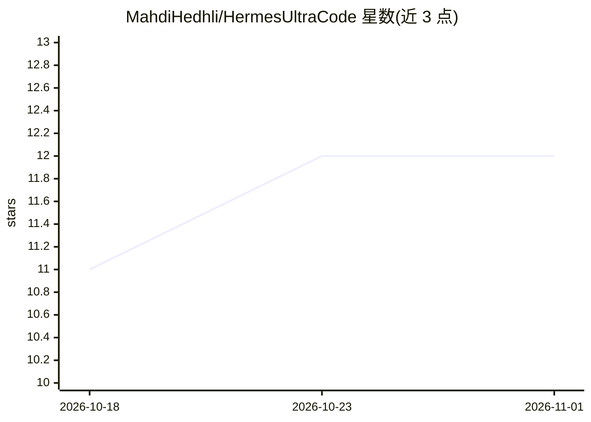

# MahdiHedhli/HermesUltraCode

⭐ 12 · Python · NOASSERTION · 推送 2026-07-29 · [GitHub](https://github.com/MahdiHedhli/HermesUltraCode) · 个人维护

**Hermes Agent 插件：子代理派发前经跨模型实验室审查门控**

面向 Hermes Agent（Nous Research）的插件，在编排器把任务派发给子代理之前插入一道审查门：由运行在不同模型实验室的中立审查者对任务提示做结构化裁决（pass/revise/block），只能追加约束或阻止、不可改写；派发内容为原始提示加追加指令，放行决策由代码而非对话完成。审查者缺席、超时或不可解析时一律 fail-closed 阻断。每次派发写入不可变、脱敏的审计记录，提供 Hermes 仪表盘原生标签页与独立仪表盘，核心仅依赖标准库，附 208 个离线测试。

## 筛选速览

| 维度 | 判定 | 备注 |
|---|---|---|
| AI 角色 | `ai-ecosystem` | LLM/agent 周边工具 |
| 许可风险 | `permissive` | NOASSERTION |
| 部署形态 | `library` | 以包/库形式分发 |
| 模型依赖 | — | README 未给出锁定关系 |
| 硬件要求 | — | 无带数字的原话,不猜 |
| 安装摩擦 | `low` | 无编译、无系统依赖或容器化 |
| 成熟度 | — | 结构信号不足 |

## 能力要点

- 跨实验室审查：审查者必须与编排者属不同模型实验室，启动时强制校验
- tighten-only：审查者只能追加约束或阻止，基础提示逐字保留
- fail-closed：缺审查者/超时/不可解析一律阻断并升级，不放行
- 不可变脱敏审计记录 + 只读仪表盘与可选只读 MCP 服务

## 适用场景

- 给 Hermes 多代理工作流加派发前审查与提示收紧
- 满足需要留痕审计的代码生成流程（ISO 27001 风格证据链）
- 降低提示注入经 issue/PR 文本进入子代理的风险

## 场景标签

`多智能体` · 领域:Agent 开发

## 证据(README 行号)

> L12: HermesUltraCode is a plugin for Hermes Agent (Nous Research), not a
> L49: does **not** rebuild Hermes — it wraps the subagent-dispatch boundary so no worker prompt
> L140: |**Hermes plugin**|`__init__.py` + `plugin.yaml` + `adapters/hermes_hook.py`|The Hermes-coupled layer. `register(c

## 星数曲线

2026-10-18 11 → 2026-11-01 12（+1）

---
*卡片 v1 · prompt 1.4 · 生成 2026-11-01 · 置信度 mid · 依据 README sha `8ff7496621f0` · [字段定义](../../DATASET.md)*
