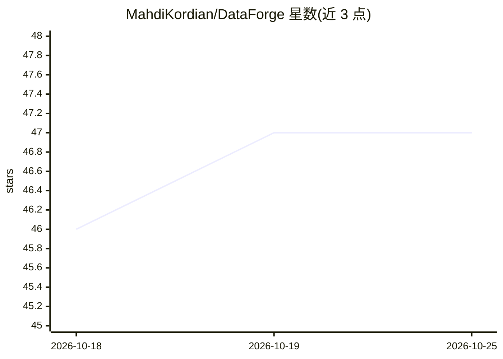

# MahdiKordian/DataForge

⭐ 48 · Python · Apache-2.0 · 推送 2026-10-08 · [GitHub](https://github.com/MahdiKordian/DataForge) · [官网](https://dataforge-prep.streamlit.app/) · 个人维护

**面向 ML 的引导式数据预处理 Web 应用：脏数据进、可建模数据出**

基于 Python 与 Streamlit 的多页 Web 应用，覆盖数据准备全流程：加载（文件/粘贴/URL/内置样例）、健康度仪表盘与问题清单、Clean/Transform/Encode/Scale/Split 五步引导式处理、九个分析视图（分布/缺失/相关性/离群点/PCA 等）、逐步快照与撤销、操作日志与 HTML/Markdown 报告导出。数据仅存于当前会话。面向学生、分析师与 ML 工程师，无需编写 pandas 代码。提供在线 demo 与本地运行（Python 3.10+）两种方式。

## 筛选速览

| 维度 | 判定 | 备注 |
|---|---|---|
| AI 角色 | `ai-ecosystem` | LLM/agent 周边工具 |
| 许可风险 | `permissive` | Apache-2.0 |
| 部署形态 | `None` |  |
| 模型依赖 | — | README 未给出锁定关系 |
| 硬件要求 | — | 无带数字的原话,不猜 |
| 安装摩擦 | `low` | 无编译、无系统依赖或容器化 |
| 成熟度 | — | 结构信号不足 |

## 能力要点

- 五步预处理管道（Clean/Transform/Encode/Scale/Split），支持分层切分与类别不平衡采样
- ML 就绪度评分与按严重性排序的问题清单
- 九个分析视图含相关性、VIF、离群点检测与 PCA
- 每步快照、撤销、完整审计日志与可分享报告

## 适用场景

- 不想反复写 pandas 预处理代码的数据科学学习者
- 上传表格数据做探索性分析与清洗后导出
- 为建模准备无泄漏的训练/验证/测试切分

## 场景标签

 · 领域:数据科学/机器学习工具

## 证据(README 行号)

> L3: Load a dataset, see what is wrong with it, fix it step by step, and export something your model can use.
> L25: DataForge turns that routine into one guided web app. It inspects your dataset, flags what is wrong, applies the fi
> L33: - **Guided preparation.** Five steps (Clean, Transform, Encode, Scale, Split) with sensible defaults and full contr

## 星数曲线

2026-10-18 46 → 2026-10-25 47（+1）

---
*卡片 v1 · prompt 1.4 · 生成 2026-10-25 · 置信度 high · 依据 README sha `d605e2ed73a7` · [字段定义](../../DATASET.md)*
