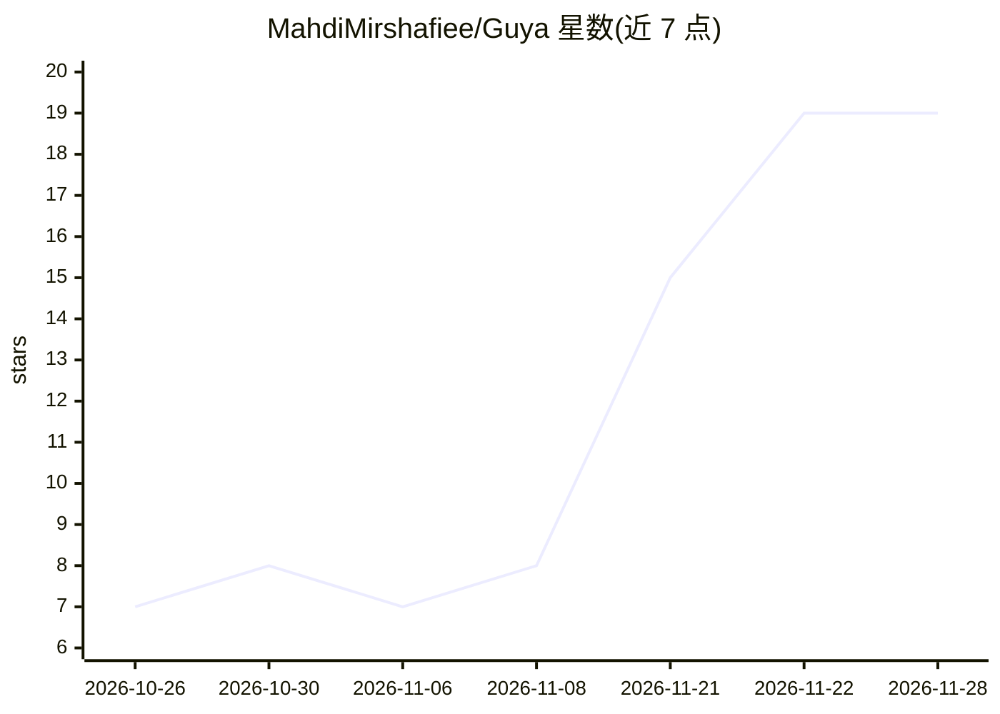

# MahdiMirshafiee/Guya

⭐ 19 · JavaScript · MIT · 推送 2026-10-18 · [GitHub](https://github.com/MahdiMirshafiee/Guya) · 个人维护

**桌面快捷键语音转文字工具，音频直发 Gemini API，结果进剪贴板**

基于 Electron 的桌面语音转文字工具：按全局快捷键录音，音频经用户自己的 Gemini API key 直接送至 Google API，无中间服务器，转录结果复制到剪贴板或自动键入焦点应用。支持 macOS/Windows/Linux 三平台与 arm64/x64 双架构的安装包；key 用系统 keychain/DPAPI 加密存储；内置基于分贝的电平表与浮动球、静音自动停止、波斯语/英语双语界面与 RTL 排版。转录质量与配额受用户所选模型和 key 限制，安装包未做代码签名。

## 筛选速览

| 维度 | 判定 | 备注 |
|---|---|---|
| AI 角色 | `ai-native` | 本体是模型或模型工具 |
| 许可风险 | `permissive` | MIT |
| 部署形态 | `desktop` | 安装包/桌面程序 |
| 模型依赖 | — | README 未给出锁定关系 |
| 硬件要求 | — | 无带数字的原话,不猜 |
| 安装摩擦 | `low` | 无编译、无系统依赖或容器化 |
| 成熟度 | — | 结构信号不足 |

## 能力要点

- 全局快捷键录音→Gemini 转录→剪贴板/自动键入
- 音频仅发送 Gemini API，key 经系统 keychain/DPAPI 加密存储
- 静音 3 秒自动结束，8 秒无人说话不发送任何请求
- 安装包覆盖 macOS/Windows/Linux 双架构，含 Windows 便携版

## 适用场景

- 按一个快捷键把口述内容转成文字并粘贴到任意应用
- 波斯语使用者的桌面听写与 RTL 文本录入
- 不希望常驻麦克风监听的本地语音输入

## 场景标签

`语音识别` · 领域:感知与多模态

## 证据(README 行号)

> L3: **Voice to text on your desktop, with your own Gemini key.** One shortcut records,
> L18: - **One key, one job.** Press the shortcut, speak, press it again. The transcript is

## 星数曲线

2026-10-26 7 → 2026-11-28 19（+12）

---
*卡片 v1 · prompt 1.4 · 生成 2026-11-20 · 置信度 high · 依据 README sha `c30aa2f90c30` · [字段定义](../../DATASET.md)*
