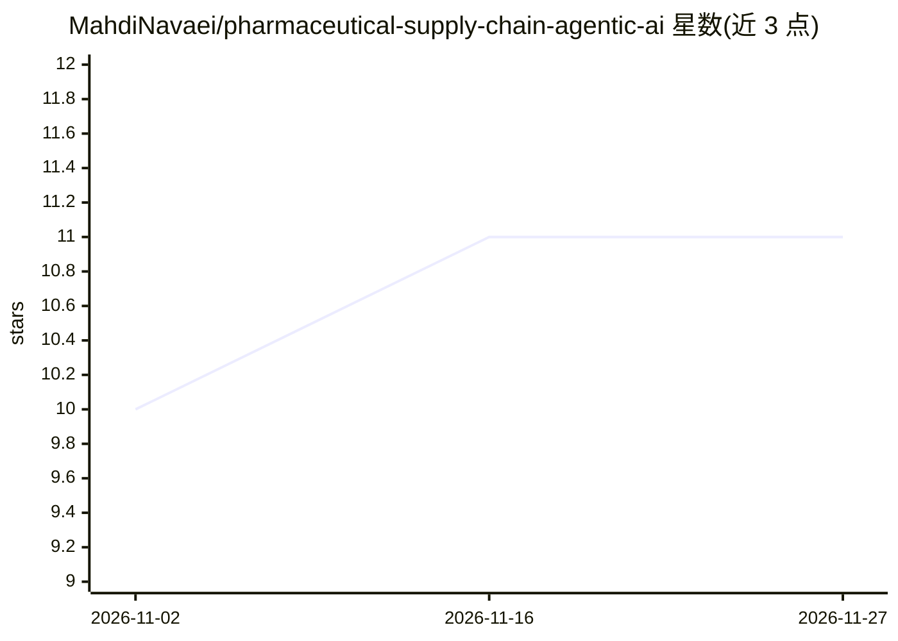

# MahdiNavaei/pharmaceutical-supply-chain-agentic-ai

⭐ 11 · Python · 推送 2026-01-02 · [GitHub](https://github.com/MahdiNavaei/pharmaceutical-supply-chain-agentic-ai) · [官网](https://mahdinavaei.github.io/resume-site/) · 个人维护

**制药供应链管理 AI 系统：四智能体做预测/路径/库存/告警**

由 FastAPI 后端、Next.js 前端与 MongoDB 组成的制药供应链管理平台，采用 LangGraph 编排四个智能体：需求预测（Prophet/LSTM/移动平均）、配送路径优化（Google OR-Tools VRP/TSP）、分支机构库存匹配（含 GPT-4o-mini 分析与调拨建议）、监控告警（LLM 解读）。提供 REST API（/forecast/predict、/routes/optimize、/inventory/match、/alerts 等）、KPI 仪表盘与 Swagger 文档。要求本地运行 Python 3.8+、Node.js 18+ 与 MongoDB 7.0+。

## 筛选速览

| 维度 | 判定 | 备注 |
|---|---|---|
| AI 角色 | `ai-native` | 本体是模型或模型工具 |
| 许可风险 | `permissive` | — |
| 部署形态 | `self-host` | docker 或自建部署 |
| 模型依赖 | — | README 未给出锁定关系 |
| 硬件要求 | — | 无带数字的原话,不猜 |
| 安装摩擦 | `low` | 无编译、无系统依赖或容器化 |
| 成熟度 | — | 结构信号不足 |

## 能力要点

- 四个专用智能体：预测、路径优化、库存匹配、监控告警
- LangGraph 编排智能体工作流，OpenAI GPT-4o-mini 做分析与告警解读
- Google OR-Tools VRP/TSP 多车辆路径规划（容量/时间窗/距离约束）
- REST API 覆盖预测/优化/库存/告警/工作流执行端点

## 适用场景

- 预测药品未来 30 天需求量并导出结果
- 为多分支机构优化配送路线并对比成本
- 识别分支机构过量/不足库存并生成调拨建议
- 监控库存风险并按严重级别推送告警

## 场景标签

`多智能体` · 领域:Agent 开发

## 证据(README 行号)

> L60: This project is a **comprehensive advanced AI system** for managing and optimizing the pharmaceutical supply chain 
> L123:     B --> C[LangGraph Agent Orchestration]
> L135: |**AI Models**|OpenAI GPT-4o-mini|Latest|Intelligent Analysis|

## 星数曲线

2026-11-02 10 → 2026-11-27 11（+1）

---
*卡片 v1 · prompt 1.4 · 生成 2026-11-19 · 置信度 mid · 依据 README sha `ed5ac42023b3` · [字段定义](../../DATASET.md)*
