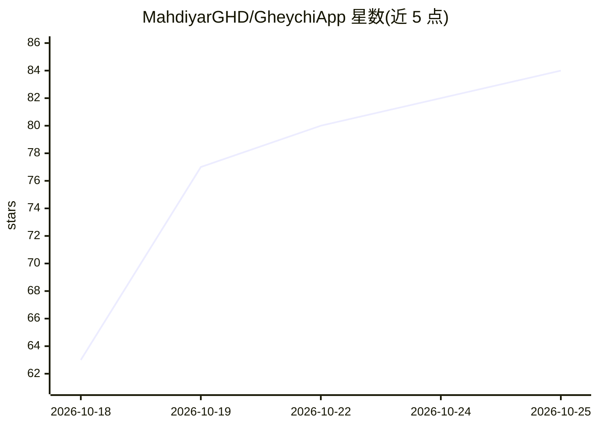

# MahdiyarGHD/GheychiApp

⭐ 84 · C# · GPL-3.0 · 推送 2026-10-23 · [GitHub](https://github.com/MahdiyarGHD/GheychiApp) · 个人维护

**安卓短信应用：本地 AI 识别并隔离垃圾短信**

用 Avalonia 构建的开源安卓短信应用（波斯语界面，附英文版），核心功能是 ML.NET 在设备端运行的垃圾短信检测：无网络、短信文本不出设备；垃圾短信无通知无声并自动定时清理，支持三档灵敏度、模型应用内更新（模型训练于独立仓库 sms-spam-dataset）。同时也是完整短信应用：多 SIM 卡、文件夹、定时发送、一次性验证码识别、回收站、语音搜索等。仅用户主动举报时短信文本才出设备且可先编辑。安装提供 APK（Android 7.0+），也可用 .NET SDK 10 + JDK 17 从源码构建。

## 筛选速览

| 维度 | 判定 | 备注 |
|---|---|---|
| AI 角色 | `ai-enhanced` | 去掉 AI 部分产品仍成立 |
| 许可风险 | `viral` | GPL-3.0 |
| 部署形态 | `None` |  |
| 模型依赖 | — | README 未给出锁定关系 |
| 硬件要求 | — | 无带数字的原话,不猜 |
| 安装摩擦 | `medium` | 含编译或系统依赖之一 |
| 成熟度 | — | 结构信号不足 |

## 能力要点

- ML.NET 模型完全在设备端离线运行，短信文本不外发
- 垃圾短信静默隔离、自动过期清理，含每日摘要与统计图表
- 模型从 sms-spam-dataset 仓库独立更新，无需重装应用
- 完整短信功能：多 SIM 卡、自定义/智能文件夹、定时与延迟发送、验证码复制

## 适用场景

- 在安卓上收短信时自动把广告和骚扰短信隔离到垃圾箱
- 不想让短信内容上传服务器的前提下用 AI 过滤
- 用带文件夹和验证码复制功能的完整短信应用替换系统应用

## 场景标签

 · 领域:通讯/移动应用

## 证据(README 行号)

> L21: قیچی یه برنامه‌ی پیامک کامله که این پیام‌ها رو با هوش مصنوعی **روی خود گوشی** تشخیص می‌ده و بی‌سروصدا می‌فرستتشون ت
> L30: * مدل هوش مصنوعی با ML.NET که بدون اینترنت و کاملاً روی خود گوشی اجرا می‌شه.

## 星数曲线

2026-10-18 63 → 2026-10-25 84（+21）

---
*卡片 v1 · prompt 1.4 · 生成 2026-10-24 · 置信度 high · 依据 README sha `93d62127af14` · [字段定义](../../DATASET.md)*
