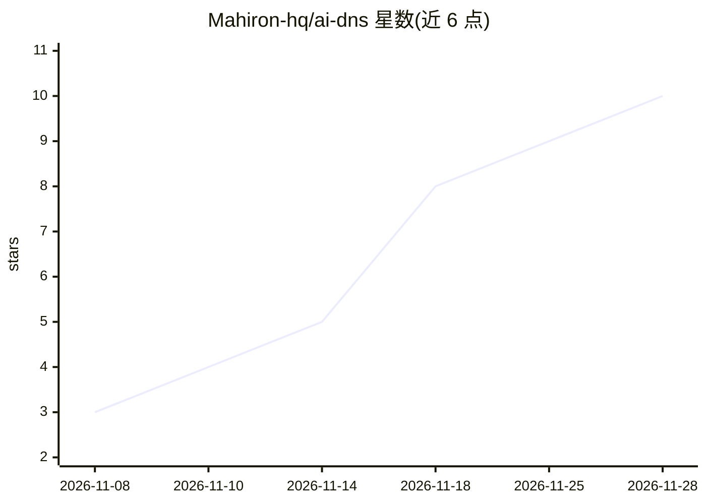

# Mahiron-hq/ai-dns

⭐ 10 · PowerShell · Apache-2.0 · 推送 2026-11-26 · [GitHub](https://github.com/Mahiron-hq/ai-dns) · 个人维护 · 中文 README

**Windows 用户一键筛选可用 smart DNS 访问 ChatGPT/Claude/Gemini**

Windows 平台的 PowerShell 批处理工具：从内置与远程列表合并的 57 个 smart DNS 服务器中逐一探测，通过 Cloudflare 区域端点与 OpenAI/Anthropic/Gemini API 的假密钥响应验证各服务器能否打开目标服务，按可打开的必选服务数与延迟排序后写入系统 DNS 并配置 NRPT/DoH 规则。首次修改前备份原设置，Disable 脚本精确回滚。依赖管理员权限；不支持 TLS 按站点名被重置的网络环境（TSPU 过滤），此类情况会明确提示。

## 筛选速览

| 维度 | 判定 | 备注 |
|---|---|---|
| AI 角色 | `ai-enhanced` | 去掉 AI 部分产品仍成立 |
| 许可风险 | `permissive` | Apache-2.0 |
| 部署形态 | `desktop` | 安装包/桌面程序 |
| 模型依赖 | — | README 未给出锁定关系 |
| 硬件要求 | — | 无带数字的原话,不猜 |
| 安装摩擦 | `low` | 无编译、无系统依赖或容器化 |
| 成熟度 | — | 结构信号不足 |

## 能力要点

- 双击脚本自动探测数十个 smart DNS 并启用最优服务器，保留备份回滚
- 通过 Cloudflare /cdn-cgi/trace 区域与 OpenAI/Anthropic/Gemini API 假密钥响应验证服务可用性
- 必选/可选服务模式与自定义域名（如 perplexity.ai）的严格校验
- -TestOnly/-DryRun/-Trace 等运行键与 Pester 自动测试

## 适用场景

- 一键为 ChatGPT、Claude、Gemini 找到当前可用的 smart DNS
- 服务打不开时回滚 DNS 到修改前的精确状态
- 把自定义域名纳入 DNS 切换的检查范围

## 场景标签

 · 领域:网络工具/访问配置

## 证据(README 行号)

> L18: Smart DNS отвечает на запросы к сервисам с региональными ограничениями адресом своего прокси, и
> L21: сервис через прокси, который сервер действительно выдаёт, и включает лучший. Настройки, которые были

## 星数曲线

2026-11-08 3 → 2026-11-28 10（+7）

---
*卡片 v1 · prompt 1.4 · 生成 2026-11-20 · 置信度 high · 依据 README sha `9fc4aa8cf657` · [字段定义](../../DATASET.md)*
